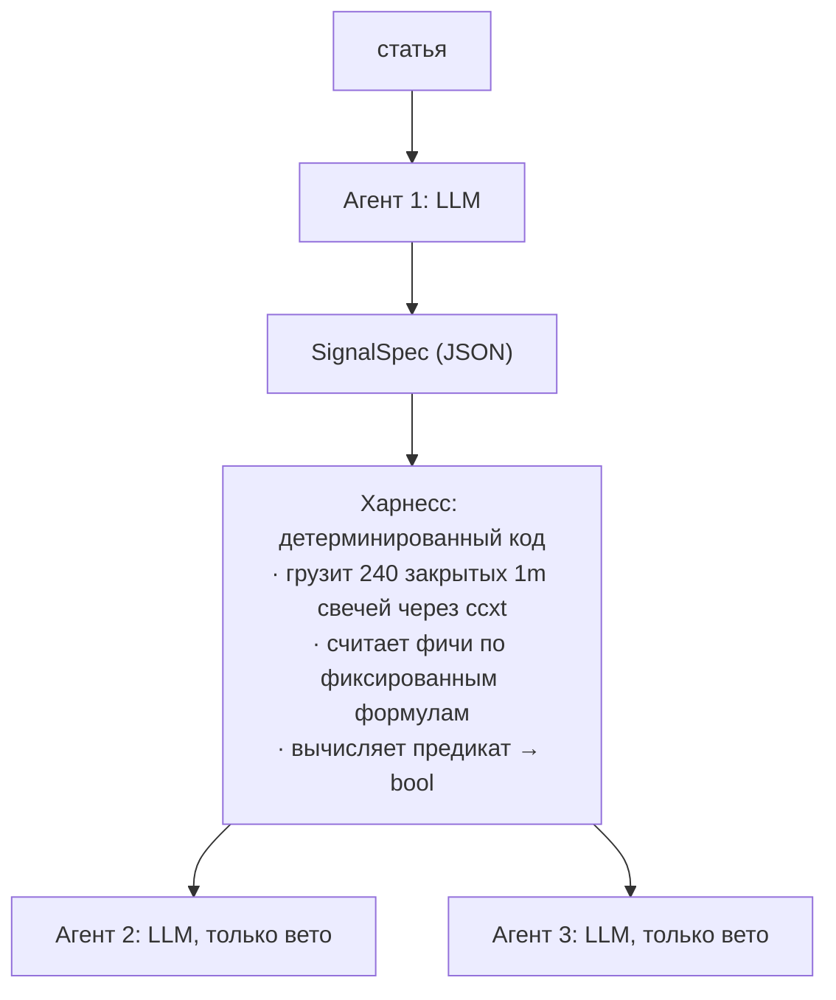

# PLAN.md — конвейер из трёх агентов: разбор обзора → вход → выход

Версия документа: 1.0.0
Дата: 2026-10-23

---

## 0. Назначение и границы

Конвейер извлекает из ежедневного рыночного обзора **фальсифицируемое утверждение о последующем движении** и переводит его в предикат, вычислимый на 240 последних закрытых минутных свечах. Если такого утверждения в тексте нет либо оно невычислимо на свечах — конвейер обязан вернуть «сигнала нет».

Это измерительный стенд, а не торговая система. До прогона на реальных деньгах обязательны пункты раздела 11. Документ описывает инженерную конструкцию и не является инвестиционной рекомендацией; автор документа не лицензированный финансовый советник.

### Принятые допущения (изменить при необходимости)

| Параметр | Значение | Почему так |
|---|---|---|
| Инструмент | `BTC/USDT` | обзоры про BTC; тикер и тип рынка задаются конфигом |
| Тип рынка | спот **или** перп — но один на весь прогон | ряды спота и перпа смешивать нельзя |
| Таймфрейм условия | 1m, окно 240 бар (4 ч) | из постановки |
| Сетка запуска агентов 2 и 3 | каждые 4 ч | из постановки |
| Направление | только long | из постановки; short-сигналы отбрасываются на уровне харнесса |
| Язык промптов | русский | совпадает с языком входных статей |

---

## 1. Ключевое архитектурное решение

**Граница детерминизма проходит между агентом 1 и агентами 2/3.**



Следствия, которые нужно принять осознанно:

1. Агент 1 — единственное место, где есть свобода интерпретации. Только он читает текст.
2. Агенты 2 и 3 получают **уже посчитанные** значения фич и **уже вычисленный** булев результат. Они не имеют права превратить `false` в `true`. Их единственная функция — заблокировать действие при проблемах с данными или состоянием.
3. Из этого честно следует: агенты 2 и 3 в такой конструкции не обязательны — их логика выражается кодом. LLM там оставлен как точка расширения (например, для будущих проверок, которые трудно закодировать), но он является источником нестабильности. **Если нужен воспроизводимый бэктест — реализуйте агенты 2 и 3 как код, а LLM-версию держите только для ручного разбора случаев.**

---

## 2. Поток данных и состояние

### Сущности

```ts
type SignalSpec = Agent1Response['signal'];   // непустой

interface StoredSignal {
  signal_id: string;          // uuid, выдаёт харнесс
  article_url: string;
  article_published_at: string | null;
  created_at: string;         // ISO-8601 UTC
  expires_at: string;         // created_at + ttl_hours
  spec: SignalSpec;           // сохраняется целиком и неизменно
  status: 'pending' | 'opened' | 'expired' | 'rejected';
}

interface Position {
  signal_id: string;          // ссылка на StoredSignal
  opened_at: string;
  entry_price: number;
  qty: number;
  periods_held: number;       // число прошедших 4h-тиков
  exchange_stop_order_id: string | null;
}
```

**Критично:** `spec` сохраняется в момент разбора статьи и далее неизменен. Агент 3 использует `invalidation` из той же записи, по которой был вход. Повторный разбор статьи не должен менять правила открытой позиции.

### Цикл

1. **Разбор** (по факту публикации статьи): агент 1 → `Agent1Response`. При `signal !== null` создаётся `StoredSignal` со `status: 'pending'`.
2. **Тик входа** (каждые 4 ч): для каждого `pending` сигнала харнесс считает фичи, вычисляет `entry`, передаёт агенту 2. При `open_long` → ордер, `Position`, `status: 'opened'`.
3. **Тик выхода** (каждые 4 ч): для каждой открытой позиции харнесс считает фичи, вычисляет `invalidation`, проверяет стопы, передаёт агенту 3.
4. **Истечение**: `pending`-сигнал с `now > expires_at` → `status: 'expired'`, в агент 2 не передаётся.

### Жёсткие правила харнесса

- В окно попадают **только закрытые** бары. Последний незакрытый бар отбрасывается всегда: `candles.slice(0, -1).slice(-240)`. Нарушение этого правила даёт lookahead, который в бэктесте незаметен, а в лайве превращается в убыток.
- Все метки времени — epoch ms UTC.
- Если `bars_available < 240` — не торговать, вернуть вето.
- Одновременно открыта максимум одна позиция по инструменту.
- `ccxt`: `enableRateLimit: true`, пагинация по `since`, сверка числа баров после склейки.

---

## 3. Фиксированный словарь фич

Окно `W` = последние 240 закрытых 1m бара, `W[0]` — самый старый, `W[-1]` — последний закрытый.

Агент 1 **не имеет права** использовать имена вне этой таблицы. Любое утверждение статьи, не выразимое через неё, помечается как невычислимое.

| Имя | Тип | Формула |
|---|---|---|
| `last_price` | number | `close(W[-1])` |
| `window_open` | number | `open(W[0])` |
| `window_high` | number | `max(high(W))` |
| `window_low` | number | `min(low(W))` |
| `range_pct` | number | `(window_high - window_low) / window_low * 100` |
| `ret_window_pct` | number | `(last_price / window_open - 1) * 100` |
| `ret_15m_pct` | number | `(last_price / close(W[-16]) - 1) * 100` |
| `ret_60m_pct` | number | `(last_price / close(W[-61]) - 1) * 100` |
| `realized_vol_pct` | number | `stdev(ln(close_i / close_{i-1})) * sqrt(240) * 100` — реализованная волатильность за окно, в % |
| `atr_14_pct` | number | `ATR_Wilder(14, W) / last_price * 100` |
| `vwap_window` | number | `sum(tp_i * vol_i) / sum(vol_i)`, где `tp_i = (h_i + l_i + c_i) / 3` |
| `dist_from_vwap_pct` | number | `(last_price / vwap_window - 1) * 100` |
| `volume_window` | number | `sum(vol(W))` |
| `volume_ratio_60_180` | number | `sum(vol(W[-60:])) / (sum(vol(W[-240:-60])) / 3)` |
| `up_bar_fraction` | number | `count(close_i > open_i) / bars_available` |
| `max_drawdown_window_pct` | number | `max_i((runmax_high_{<=i} - low_i) / runmax_high_{<=i}) * 100` |
| `bars_available` | integer | число непропущенных бар в `W` |
| `minutes_since_window_end` | number | `(now - closeTime(W[-1])) / 60000` — свежесть данных |

### Операторы

| Оператор | Семантика |
|---|---|
| `lt`, `lte`, `gt`, `gte` | обычное сравнение `feature OP value` |
| `crosses_above` | `window_low <= value && last_price > value` |
| `crosses_below` | `window_high >= value && last_price < value` |

`crosses_*` применимы только к `last_price`. Семантика умышленно упрощена до «внутри окна были по обе стороны уровня» — это детерминированно и не зависит от порядка обхода.

### Ограничения предиката (проверяет харнесс, не LLM)

- глубина вложенности ≤ 3
- суммарное число листьев ≤ 8
- `value` — число либо `{"feature": "<имя из словаря>"}`
- схема, не прошедшая эти проверки, отклоняется целиком; сигнал получает `status: 'rejected'`

---

## 4. Предикат: общее определение схемы

Переиспользуется агентами 1, 2, 3 через `$ref`.

```json
{
  "$schema": "https://json-schema.org/draft/2020-12/schema",
  "$id": "https://example.invalid/schemas/predicate.schema.json",
  "$defs": {
    "featureName": {
      "enum": [
        "last_price", "window_open", "window_high", "window_low",
        "range_pct", "ret_window_pct", "ret_15m_pct", "ret_60m_pct",
        "realized_vol_pct", "atr_14_pct", "vwap_window", "dist_from_vwap_pct",
        "volume_window", "volume_ratio_60_180", "up_bar_fraction",
        "max_drawdown_window_pct", "bars_available", "minutes_since_window_end"
      ]
    },
    "leaf": {
      "type": "object",
      "additionalProperties": false,
      "required": ["feature", "op", "value"],
      "properties": {
        "feature": { "$ref": "#/$defs/featureName" },
        "op": { "enum": ["lt", "lte", "gt", "gte", "crosses_above", "crosses_below"] },
        "value": {
          "oneOf": [
            { "type": "number" },
            {
              "type": "object",
              "additionalProperties": false,
              "required": ["feature"],
              "properties": { "feature": { "$ref": "#/$defs/featureName" } }
            }
          ]
        }
      }
    },
    "predicate": {
      "oneOf": [
        { "$ref": "#/$defs/leaf" },
        {
          "type": "object",
          "additionalProperties": false,
          "required": ["all"],
          "properties": {
            "all": {
              "type": "array", "minItems": 1, "maxItems": 6,
              "items": { "$ref": "#/$defs/predicate" }
            }
          }
        },
        {
          "type": "object",
          "additionalProperties": false,
          "required": ["any"],
          "properties": {
            "any": {
              "type": "array", "minItems": 1, "maxItems": 6,
              "items": { "$ref": "#/$defs/predicate" }
            }
          }
        },
        {
          "type": "object",
          "additionalProperties": false,
          "required": ["not"],
          "properties": { "not": { "$ref": "#/$defs/predicate" } }
        }
      ]
    }
  }
}
```

---

## 5. Агент 1 — классификатор статьи

### Роль

Прочитать текст обзора и определить: это итог без вывода, или есть вывод о последующем движении. При наличии вывода — выдать условие активации и условие потери актуальности, выразимые через словарь из раздела 3.

### Системный промпт

```
Ты — классификатор рыночных обзоров. Ты получаешь полный текст одной статьи и
возвращаешь ОДИН JSON-объект по заданной схеме. Никакого текста вне JSON.

ТВОЯ ЗАДАЧА
Определить, содержит ли статья фальсифицируемое утверждение о БУДУЩЕМ движении
цены, и если да — перевести его в предикат над закрытым словарём фич.

ОПРЕДЕЛЕНИЯ

Фальсифицируемое утверждение о будущем — такое, которое может оказаться ложным
по наблюдаемым данным. Оно должно иметь направление (вверх/вниз) и относиться к
цене актива.

Не является таким утверждением:
- описание уже произошедшего («цена снизилась», «диапазон недели составил»);
- значение индикатора на сейчас («индекс страха и жадности 50»);
- модальная конструкция, покрывающая оба направления («может способствовать
  росту», «могут усилить отток») — помечай kind = "forward_hedged";
- универсальный совет («целесообразно диверсифицировать», «сохранять взвешенный
  подход») — помечай kind = "advice_generic";
- датированное будущее событие факта («ETF начнёт торговаться в ноябре») —
  помечай kind = "dated_event"; это факт календаря, а не прогноз цены.

ПРАВИЛА, НАРУШЕНИЕ КОТОРЫХ СЧИТАЕТСЯ ОШИБКОЙ

1. ЦИТАТА ОБЯЗАТЕЛЬНА. Для каждого claim поле evidence_quote должно быть
   дословной подстрокой статьи. Не перефразируй, не сокращай, не исправляй
   опечатки. Если дословной цитаты нет — claim не существует.

2. НЕ ДОМЫСЛИВАЙ. Запрещено выводить направление из своих знаний о рынке, из
   названий новостей, из общего тона текста или из того, что «обычно бывает».
   Направление берётся только из прямого утверждения автора.

3. НЕВЫРАЗИМОЕ ПОМЕЧАЙ КАК НЕВЫРАЗИМОЕ. Предикат вычисляется ИСКЛЮЧИТЕЛЬНО на
   240 минутных свечах торгуемого инструмента. Если утверждение опирается на
   потоки в ETF, объёмы on-chain, индекс страха и жадности, регуляторные
   события, курс другого актива, макроданные или что-либо ещё вне этих свечей —
   ставь expressible_on_target = false и заполни inexpressible_reason. НЕ
   придумывай ценовую прокси вместо этого. Подмена невыразимого утверждения
   ценовым суррогатом — худшая из возможных ошибок: она создаёт сигнал, которого
   в статье не было.

4. НЕ ТОТ АКТИВ — НЕ ВЫРАЗИМО. Утверждение про ETH или альткоины невыразимо на
   свечах BTC, даже если кажется связанным.

5. ТОЛЬКО LONG. Если единственное направленное утверждение — вниз, signal = null.
   Направление вниз фиксируй в claims, но сигнал не формируй.

6. ПО УМОЛЧАНИЮ — НЕТ СИГНАЛА. verdict = "summary_only" это нормальный и частый
   исход. Отсутствие вывода в статье не является твоей неудачей. Формируй signal
   только когда есть хотя бы один claim с kind = "forward_directional",
   direction = "up", falsifiable = true и expressible_on_target = true.

7. СЛОВАРЬ ЗАКРЫТ. Имена фич и операторы — только из предоставленного перечня.
   Любое другое имя делает ответ невалидным.

8. УРОВНИ — ТОЛЬКО ИЗ ТЕКСТА. Числовой уровень в предикате допустим лишь если он
   назван в статье явно. Не округляй его и не подбирай «похожий».

9. CONFIDENCE НЕ ВЫШЕ "medium". Шкала умышленно ограничена: источник — дневной
   дайджест, публикуемый после событий, которые он объясняет.

ЗАПОЛНЕНИЕ signal (когда он не null)

- entry: условие, при котором утверждение автора считается активированным.
  Формулируй консервативно — лучше более узкое условие, которое срабатывает
  редко, чем широкое, срабатывающее всегда. Условие вида
  "last_price > 0" или иное всегда-истинное запрещено.
- invalidation: условие, при котором утверждение автора перестало быть
  актуальным. Это НЕ логическое отрицание entry. Это наблюдаемый признак того,
  что сценарий автора сломался (например: цена ушла ниже названного им уровня
  поддержки).
- hard_stop: риск-ограничение. Оно НЕ выводится из статьи — ставь значение по
  умолчанию mode = "atr_multiple", value = 2.0, если в статье нет явного уровня
  стопа. Если явный уровень есть — mode = "price", value = этот уровень.
- max_holding_periods: число 4-часовых тиков. По умолчанию 6 (24 часа): срок
  годности утверждения из ежедневного обзора истекает с публикацией следующего.
- ttl_hours: сколько часов сигнал ждёт выполнения entry. По умолчанию 24.

ФОРМАТ ОТВЕТА
Один JSON-объект, строго по схеме, без markdown-обёртки и комментариев.
```

### JSON Schema ответа

```json
{
  "$schema": "https://json-schema.org/draft/2020-12/schema",
  "$id": "https://example.invalid/schemas/agent1.response.schema.json",
  "title": "Agent1Response",
  "type": "object",
  "additionalProperties": false,
  "required": ["schema_version", "article", "verdict", "claims", "signal", "data_quality_flags"],
  "properties": {
    "schema_version": { "const": "1.0.0" },

    "article": {
      "type": "object",
      "additionalProperties": false,
      "required": ["url", "published_at", "data_timestamp_present"],
      "properties": {
        "url": { "type": "string", "minLength": 1 },
        "published_at": { "type": ["string", "null"], "description": "ISO-8601 UTC, null если в тексте нет" },
        "data_timestamp_present": {
          "type": "boolean",
          "description": "true, если статья указывает время снимка данных (например «по состоянию на 07:20»)"
        },
        "data_asof_note": { "type": ["string", "null"], "maxLength": 300 }
      }
    },

    "verdict": {
      "enum": ["summary_only", "forecast_not_expressible", "forecast_expressible"],
      "description": "summary_only — фальсифицируемого прогноза нет; forecast_not_expressible — есть, но невычислим на свечах инструмента; forecast_expressible — есть и вычислим"
    },

    "claims": {
      "type": "array",
      "minItems": 0,
      "maxItems": 12,
      "items": {
        "type": "object",
        "additionalProperties": false,
        "required": ["id", "evidence_quote", "kind", "asset", "direction", "falsifiable", "expressible_on_target"],
        "properties": {
          "id": { "type": "string", "pattern": "^c[0-9]{1,2}$" },
          "evidence_quote": {
            "type": "string", "minLength": 10, "maxLength": 600,
            "description": "ДОСЛОВНАЯ подстрока статьи"
          },
          "kind": {
            "enum": ["forward_directional", "forward_hedged", "state_description", "advice_generic", "dated_event"]
          },
          "asset": { "enum": ["BTC", "ETH", "ALTS", "MARKET", "OTHER"] },
          "direction": { "enum": ["up", "down", "none"] },
          "falsifiable": { "type": "boolean" },
          "expressible_on_target": { "type": "boolean" },
          "inexpressible_reason": {
            "type": ["string", "null"], "maxLength": 300,
            "description": "обязателен при expressible_on_target = false"
          }
        }
      }
    },

    "signal": {
      "oneOf": [
        { "type": "null" },
        {
          "type": "object",
          "additionalProperties": false,
          "required": ["direction", "asset", "based_on_claim_ids", "entry", "invalidation", "hard_stop", "max_holding_periods", "ttl_hours", "confidence", "rationale"],
          "properties": {
            "direction": { "const": "long" },
            "asset": { "const": "BTC" },
            "based_on_claim_ids": {
              "type": "array", "minItems": 1, "maxItems": 4,
              "items": { "type": "string", "pattern": "^c[0-9]{1,2}$" }
            },
            "entry": { "$ref": "predicate.schema.json#/$defs/predicate" },
            "invalidation": { "$ref": "predicate.schema.json#/$defs/predicate" },
            "hard_stop": {
              "type": "object",
              "additionalProperties": false,
              "required": ["mode", "value"],
              "properties": {
                "mode": { "enum": ["atr_multiple", "percent", "price"] },
                "value": { "type": "number", "exclusiveMinimum": 0 }
              }
            },
            "max_holding_periods": { "type": "integer", "minimum": 1, "maximum": 42 },
            "ttl_hours": { "type": "number", "minimum": 1, "maximum": 48 },
            "confidence": { "enum": ["low", "medium"] },
            "rationale": { "type": "string", "minLength": 20, "maxLength": 800 }
          }
        }
      ]
    },

    "data_quality_flags": {
      "type": "array",
      "maxItems": 8,
      "items": {
        "enum": [
          "no_publication_time",
          "no_data_snapshot_time",
          "internal_numeric_inconsistency",
          "number_reused_across_contexts",
          "logical_incoherence",
          "source_dates_precede_publication"
        ]
      }
    }
  },

  "allOf": [
    {
      "if": { "properties": { "verdict": { "const": "forecast_expressible" } }, "required": ["verdict"] },
      "then": { "properties": { "signal": { "type": "object" } } }
    },
    {
      "if": { "properties": { "verdict": { "enum": ["summary_only", "forecast_not_expressible"] } }, "required": ["verdict"] },
      "then": { "properties": { "signal": { "type": "null" } } }
    }
  ]
}
```

### Пост-валидация харнессом (схема это не проверит)

1. Каждый `evidence_quote` — дословная подстрока статьи после нормализации пробелов. Иначе `rejected`.
2. `entry` не является всегда-истинным: прогнать на случайных исторических окнах, доля срабатываний < 95 %.
3. Все числовые литералы в `entry`/`invalidation` встречаются в тексте статьи.
4. `based_on_claim_ids` ссылаются на существующие claim с `kind = "forward_directional"`, `direction = "up"`, `expressible_on_target = true`.
5. Ограничения глубины и числа листьев из раздела 3.

---

## 6. Агент 2 — вход

### Роль

Раз в 4 часа: получив посчитанные фичи и **уже вычисленный** результат предиката, разрешить или заблокировать открытие позиции.

### Системный промпт

```
Ты — контролёр входа в позицию. Раз в 4 часа ты получаешь JSON с: сохранённой
спецификацией сигнала, значениями фич, посчитанными детерминированным кодом,
уже вычисленным результатом предиката входа и текущим состоянием портфеля.

Ты возвращаешь ОДИН JSON-объект по схеме. Никакого текста вне JSON.

ТЫ НЕ СЧИТАЕШЬ АРИФМЕТИКУ. Значения фич и булев результат предиката уже
посчитаны и являются истиной. Ты не пересчитываешь их, не оспариваешь и не
интерпретируешь «по смыслу».

ТЫ НЕ МОЖЕШЬ РАЗРЕШИТЬ ВХОД, ЕСЛИ entry_predicate_result.value = false.
Это абсолютное ограничение. При false единственное допустимое действие —
"hold_flat". Ты не имеешь права счесть условие «почти выполненным».

ТВОЯ ЕДИНСТВЕННАЯ СВОБОДА — ВЕТО. Даже при entry_predicate_result.value = true
ты обязан вернуть "hold_flat" с указанием veto_reason, если верно любое из:

- bars_available < 240                      -> "insufficient_bars"
- minutes_since_window_end > 10             -> "stale_data"
- portfolio.open_position != null           -> "position_already_open"
- now > signal.expires_at                   -> "signal_expired"
- значение фичи явно аномально: нулевой или
  отсутствующий объём за окно, range_pct = 0,
  realized_vol_pct = 0, отрицательная цена   -> "feature_anomaly"

Порядок проверки — в том же порядке, что выше; возвращай первую сработавшую
причину.

Если ничего не сработало и entry_predicate_result.value = true, действие —
"open_long", veto_reason = null.

В поле notes пиши одну короткую фразу о фактическом основании решения. Не
добавляй рыночных суждений, прогнозов и оценок привлекательности сделки — это
не твоя функция.
```

### JSON Schema ответа

```json
{
  "$schema": "https://json-schema.org/draft/2020-12/schema",
  "$id": "https://example.invalid/schemas/agent2.response.schema.json",
  "title": "Agent2Response",
  "type": "object",
  "additionalProperties": false,
  "required": ["schema_version", "evaluated_at", "signal_id", "precondition_checks", "entry_predicate_echo", "decision"],
  "properties": {
    "schema_version": { "const": "1.0.0" },
    "evaluated_at": { "type": "string", "description": "ISO-8601 UTC, время тика" },
    "signal_id": { "type": "string", "minLength": 1 },

    "precondition_checks": {
      "type": "object",
      "additionalProperties": false,
      "required": ["bars_available", "minutes_since_window_end", "no_open_position", "signal_not_expired", "features_sane"],
      "properties": {
        "bars_available": { "type": "integer", "minimum": 0 },
        "minutes_since_window_end": { "type": "number", "minimum": 0 },
        "no_open_position": { "type": "boolean" },
        "signal_not_expired": { "type": "boolean" },
        "features_sane": { "type": "boolean" }
      }
    },

    "entry_predicate_echo": {
      "type": "object",
      "additionalProperties": false,
      "required": ["value", "leaf_results"],
      "description": "эхо входных данных; агент обязан воспроизвести их без изменений",
      "properties": {
        "value": { "type": "boolean" },
        "leaf_results": {
          "type": "array",
          "maxItems": 8,
          "items": {
            "type": "object",
            "additionalProperties": false,
            "required": ["feature", "op", "value", "observed", "result"],
            "properties": {
              "feature": { "type": "string" },
              "op": { "type": "string" },
              "value": { "type": ["number", "string"] },
              "observed": { "type": "number" },
              "result": { "type": "boolean" }
            }
          }
        }
      }
    },

    "decision": {
      "type": "object",
      "additionalProperties": false,
      "required": ["action", "veto_reason", "notes"],
      "properties": {
        "action": { "enum": ["open_long", "hold_flat"] },
        "veto_reason": {
          "type": ["string", "null"],
          "enum": ["insufficient_bars", "stale_data", "position_already_open", "signal_expired", "feature_anomaly", null]
        },
        "notes": { "type": "string", "maxLength": 300 }
      }
    }
  },

  "allOf": [
    {
      "if": {
        "properties": { "entry_predicate_echo": { "properties": { "value": { "const": false } }, "required": ["value"] } },
        "required": ["entry_predicate_echo"]
      },
      "then": {
        "properties": { "decision": { "properties": { "action": { "const": "hold_flat" } } } }
      }
    },
    {
      "if": {
        "properties": { "decision": { "properties": { "action": { "const": "open_long" } }, "required": ["action"] } },
        "required": ["decision"]
      },
      "then": {
        "properties": {
          "decision": { "properties": { "veto_reason": { "type": "null" } } },
          "precondition_checks": {
            "properties": {
              "no_open_position": { "const": true },
              "signal_not_expired": { "const": true },
              "features_sane": { "const": true }
            }
          }
        }
      }
    }
  ]
}
```

**Харнесс обязан перепроверить** `entry_predicate_echo` против собственного расчёта и отклонить ответ при расхождении. Это защита от того, что LLM «подправит» эхо.

---

## 7. Агент 3 — выход

### Роль

Раз в 4 часа: закрыть позицию, если сработал стоп, истёк срок удержания или сценарий статьи потерял актуальность.

### Приоритет выходов (жёсткий, не обсуждается)

```
1. hard_stop_hit      -> close, reason = "hard_stop"
2. time_stop_hit      -> close, reason = "time_stop"
3. invalidation       -> close, reason = "invalidation"
4. иначе              -> hold
```

### Системный промпт

```
Ты — контролёр выхода из позиции. Раз в 4 часа ты получаешь JSON с: открытой
позицией, сохранённой спецификацией сигнала, по которому она открыта,
значениями фич и уже вычисленными результатами проверок выхода.

Ты возвращаешь ОДИН JSON-объект по схеме. Никакого текста вне JSON.

ТЫ НЕ СЧИТАЕШЬ АРИФМЕТИКУ. Все булевы проверки уже выполнены кодом и являются
истиной.

ПРИОРИТЕТ ПРОВЕРОК — СТРОГО В ЭТОМ ПОРЯДКЕ. Возвращай первое сработавшее:
1. exit_checks.hard_stop_hit = true      -> action "close", reason "hard_stop"
2. exit_checks.time_stop_hit = true      -> action "close", reason "time_stop"
3. exit_checks.invalidation_result = true -> action "close", reason "invalidation"
Если ни одно не верно -> action "hold", reason "none".

ЗАПРЕЩЕНО УДЕРЖИВАТЬ ПОЗИЦИЮ ПРИ СРАБОТАВШЕЙ ПРОВЕРКЕ. Ты не имеешь права
вернуть "hold" при любом true среди трёх проверок — ни по каким соображениям,
включая нереализованный убыток, ожидание восстановления, близость к уровню или
собственное мнение о рынке. Решение о выходе принято заранее, в спецификации;
твоя функция — исполнить его, а не пересмотреть.

ЗАПРЕЩЕНО ЗАКРЫВАТЬ БЕЗ ОСНОВАНИЯ. Если все три проверки false, action = "hold".
Ты не можешь закрыть позицию «на всякий случай».

ВНИМАНИЕ НА РАЗРЫВ В ПРОВЕРКАХ. Между твоими запусками проходит 4 часа, и
внутри этого интервала цена не контролируется. Если
position.exchange_stop_order_id = null, добавь в notes предупреждение, что
защитный ордер на бирже отсутствует. Это не меняет твоего решения, но должно
попасть в лог.

В поле notes пиши одну короткую фразу о фактическом основании. Без прогнозов.
```

### JSON Schema ответа

```json
{
  "$schema": "https://json-schema.org/draft/2020-12/schema",
  "$id": "https://example.invalid/schemas/agent3.response.schema.json",
  "title": "Agent3Response",
  "type": "object",
  "additionalProperties": false,
  "required": ["schema_version", "evaluated_at", "position", "exit_checks", "decision"],
  "properties": {
    "schema_version": { "const": "1.0.0" },
    "evaluated_at": { "type": "string" },

    "position": {
      "type": "object",
      "additionalProperties": false,
      "required": ["signal_id", "opened_at", "entry_price", "last_price", "unrealized_pct", "periods_held", "max_holding_periods", "exchange_stop_order_id"],
      "properties": {
        "signal_id": { "type": "string", "minLength": 1 },
        "opened_at": { "type": "string" },
        "entry_price": { "type": "number", "exclusiveMinimum": 0 },
        "last_price": { "type": "number", "exclusiveMinimum": 0 },
        "unrealized_pct": { "type": "number" },
        "periods_held": { "type": "integer", "minimum": 0 },
        "max_holding_periods": { "type": "integer", "minimum": 1 },
        "exchange_stop_order_id": { "type": ["string", "null"] }
      }
    },

    "exit_checks": {
      "type": "object",
      "additionalProperties": false,
      "required": ["hard_stop_hit", "time_stop_hit", "invalidation_result", "entry_condition_still_true", "leaf_results"],
      "properties": {
        "hard_stop_hit": { "type": "boolean" },
        "time_stop_hit": { "type": "boolean" },
        "invalidation_result": { "type": "boolean" },
        "entry_condition_still_true": {
          "type": "boolean",
          "description": "справочно, в решении НЕ участвует: отрицание входа не является выходом"
        },
        "leaf_results": {
          "type": "array",
          "maxItems": 8,
          "items": {
            "type": "object",
            "additionalProperties": false,
            "required": ["feature", "op", "value", "observed", "result"],
            "properties": {
              "feature": { "type": "string" },
              "op": { "type": "string" },
              "value": { "type": ["number", "string"] },
              "observed": { "type": "number" },
              "result": { "type": "boolean" }
            }
          }
        }
      }
    },

    "decision": {
      "type": "object",
      "additionalProperties": false,
      "required": ["action", "reason", "notes"],
      "properties": {
        "action": { "enum": ["close", "hold"] },
        "reason": { "enum": ["hard_stop", "time_stop", "invalidation", "none"] },
        "notes": { "type": "string", "maxLength": 300 }
      }
    }
  },

  "allOf": [
    {
      "if": {
        "anyOf": [
          { "properties": { "exit_checks": { "properties": { "hard_stop_hit": { "const": true } }, "required": ["hard_stop_hit"] } } },
          { "properties": { "exit_checks": { "properties": { "time_stop_hit": { "const": true } }, "required": ["time_stop_hit"] } } },
          { "properties": { "exit_checks": { "properties": { "invalidation_result": { "const": true } }, "required": ["invalidation_result"] } } }
        ]
      },
      "then": { "properties": { "decision": { "properties": { "action": { "const": "close" } } } } }
    },
    {
      "if": { "properties": { "decision": { "properties": { "action": { "const": "hold" } }, "required": ["action"] } } },
      "then": { "properties": { "decision": { "properties": { "reason": { "const": "none" } } } } }
    },
    {
      "if": { "properties": { "decision": { "properties": { "action": { "const": "close" } }, "required": ["action"] } } },
      "then": { "properties": { "decision": { "properties": { "reason": { "enum": ["hard_stop", "time_stop", "invalidation"] } } } } }
    }
  ]
}
```

### Критическое замечание по стопу

Проверка стопа раз в 4 часа **стопом не является**. Между тиками риск не ограничен ничем: цена может пройти уровень и уйти дальше, а агент 3 узнает об этом через несколько часов. Поэтому:

> `hard_stop` обязан быть выставлен как реальный ордер на бирже в момент открытия позиции. Проверка в агенте 3 — только сверка состояния и страховка на случай, что ордер не прошёл.

Без биржевого стоп-ордера эта конструкция имеет неограниченный риск на интервале между тиками, и никакой бэктест на 4-часовой сетке этого не покажет.

---

## 8. Выжимка из двух разобранных обзоров

Источник: `eraperemen.info`, формат «Обзор рынка криптовалют», ежедневный дайджест.

### Структура формата (устойчива между выпусками)

Таблица показателей → F&G с комментарием → ключевые новости → разделы BTC / ETH / альткоины → «инвестиционные сигналы» → «ключевые риски» → «главный вывод дня» → список источников с датами.

### Числа

| Показатель | 22.10.2026 | 23.10.2026 | Δ между снимками |
|---|---|---|---|
| F&G | 68 (жадность), +5 | 50 (нейтрально), −18 | −18 |
| BTC/USD | 82 890,02 (−1,43 %) | 81 760,41 (+0,42 %) | −1,36 % |
| ETH/USD | 2 444,06 (−1,20 %) | 2 406,6 (+0,73 %) | −1,53 % |
| TOTAL3ES | $501,6 млрд (−1,56 %) | $495,3 млрд (+0,86 %) | −1,26 % |
| Капитализация | не указана | $2,754 трлн (−3,88 %) | — |
| Доминация BTC | 59,5 % | 59,5 % | 0 |
| Доминация ETH | 10,7 % | 10,6 % | −0,1 п.п. |
| Недельный диапазон BTC | 80 684 – 84 898 | 80 684 – 84 898 | идентичен |
| Время снимка | «07:20 Europe/Istanbul» | не указано | — |

### Содержание 22.10

Направленные утверждения: оттоки из ETH-ETF «увеличивают вероятность дальнейшей коррекции в ETH и альткоинах»; фиксация прибыли «указывает на целесообразность осторожного подхода к новым позициям». Названный уровень: $82 500 «становится ключевым для краткосрочных сценариев». Измеримое наблюдение: «волатильность биткоина приближается к минимальным значениям 2026 года». Новости: финальные правила OCC по стейблкоинам (вступают в силу середина января 2027), Alpenglow в Solana (финализация 12,8 с → 150 мс), альянс в Dogecoin, Standard Chartered покупает Zodia Custody, оттоки из ETH-ETF $1,08 млрд за октябрь.

### Содержание 23.10

Направленных утверждений нет вовсе: все обращённые в будущее фразы модальные и двусторонние («может способствовать стабилизации», «могут усилить отток»). «Главный вывод дня» — описание состояния плюс универсальный совет. Новости: HSBC RedCoin в Гонконге, одобрение первого спотового BTC-ETF в Швейцарии с запуском на SIX в ноябре, Chainlink + LG CNS, aggregator hooks в Uniswap. Притоки в BTC-ETF $1,08 млрд за три дня, $528 млн за среду. Драфт по сокращению финализации ETH до четырёх минут.

### Дефекты данных, найденные в этих двух выпусках

1. **Внутреннее противоречие (23.10).** Капитализация −3,88 % при BTC +0,42 %, ETH +0,73 %, TOTAL3ES +0,86 %. Арифметически несовместимо в одном окне → флаг `internal_numeric_inconsistency`.
2. **Одно число в двух смыслах.** 22.10: оттоки ETH-ETF $1,08 млрд за октябрь. 23.10: притоки BTC-ETF $1,08 млрд за три дня → флаг `number_reused_across_contexts`.
3. **Логическая несвязность (22.10).** «Может привести к снижению ликвидности и волатильности» — снижение волатильности подано как риск, что противоречит рамке текста → флаг `logical_incoherence`.
4. **Нет единого времени снимка.** 22.10 указывает 07:20 Europe/Istanbul, 23.10 не указывает ничего → флаги `no_data_snapshot_time`, `no_publication_time`.
5. **Источники датированы раньше публикации.** В обоих выпусках часть ссылок на день-два раньше → флаг `source_dates_precede_publication`. Это прямое указание на то, что описанные события уже оттоpгованы к моменту публикации.

### Как сверка с фактом выглядела бы, если бы разметка была возможна

Утверждение 22.10 о продолжении коррекции в ETH и альтах: от снимка 22.10 к снимку 23.10 оба упали (−1,53 % и −1,26 %) — верно. Но сам день 23.10 показан как +0,73 % и +0,86 % — то есть к моменту замера движение уже развернулось. Горизонт «краткосрочно» не определён, поэтому обе оценки защитимы. **Это и есть причина, по которой разметка таких текстов не даёт однозначной метки, а значит трек-рекорд формата не строится.** Уровень $82 500 как поддержка не удержал (BTC ушёл ниже 81 500).

---

## 9. Golden-фикстуры: ожидаемые ответы агента 1

Это регрессионные тесты. **Если ваша реализация выдаёт на этих двух статьях непустой `signal` — она галлюцинирует.**

### Фикстура A: обзор 23.10.2026

```json
{
  "schema_version": "1.0.0",
  "article": {
    "url": "https://eraperemen.info/obzor-rynka-kriptovalyut-23-10-2026",
    "published_at": null,
    "data_timestamp_present": false,
    "data_asof_note": "дата данных 2026-10-23, время снимка не указано"
  },
  "verdict": "summary_only",
  "claims": [
    {
      "id": "c1",
      "evidence_quote": "Приток $1.08 млрд за три дня поддерживает спрос на BTC и может способствовать стабилизации рынка.",
      "kind": "forward_hedged",
      "asset": "BTC",
      "direction": "up",
      "falsifiable": false,
      "expressible_on_target": false,
      "inexpressible_reason": "модальная конструкция без порога; опирается на потоки в ETF, которых нет в свечах"
    },
    {
      "id": "c2",
      "evidence_quote": "Давление на фондовые рынки и рост цен на нефть могут усилить отток капитала из рисковых активов, включая криптовалюты.",
      "kind": "forward_hedged",
      "asset": "MARKET",
      "direction": "down",
      "falsifiable": false,
      "expressible_on_target": false,
      "inexpressible_reason": "модальная конструкция; опирается на внешние рынки и нефть"
    },
    {
      "id": "c3",
      "evidence_quote": "Рынок перешёл в фазу осторожного баланса",
      "kind": "state_description",
      "asset": "MARKET",
      "direction": "none",
      "falsifiable": false,
      "expressible_on_target": false,
      "inexpressible_reason": "неоперациональная формулировка без измеримого определения"
    },
    {
      "id": "c4",
      "evidence_quote": "который начнёт торговаться на SIX Swiss Exchange в ноябре",
      "kind": "dated_event",
      "asset": "OTHER",
      "direction": "none",
      "falsifiable": true,
      "expressible_on_target": false,
      "inexpressible_reason": "событие календаря, не наблюдаемо в свечах BTC"
    }
  ],
  "signal": null,
  "data_quality_flags": [
    "no_publication_time",
    "no_data_snapshot_time",
    "internal_numeric_inconsistency",
    "source_dates_precede_publication"
  ]
}
```

### Фикстура B: обзор 22.10.2026

```json
{
  "schema_version": "1.0.0",
  "article": {
    "url": "https://eraperemen.info/obzor-rynka-kriptovalyut-22-10-2026",
    "published_at": null,
    "data_timestamp_present": true,
    "data_asof_note": "цена BTC по состоянию на 07:20 Europe/Istanbul"
  },
  "verdict": "forecast_not_expressible",
  "claims": [
    {
      "id": "c1",
      "evidence_quote": "Продолжающиеся оттоки из Ethereum-ETF и замедление притока в Bitcoin-ETF увеличивают вероятность дальнейшей коррекции в ETH и альткоинах.",
      "kind": "forward_directional",
      "asset": "ETH",
      "direction": "down",
      "falsifiable": true,
      "expressible_on_target": false,
      "inexpressible_reason": "относится к ETH и альткоинам, не к BTC; опирается на потоки в ETF, отсутствующие в свечах"
    },
    {
      "id": "c2",
      "evidence_quote": "Аналитики отмечают, что уровень $82 500 становится ключевым для краткосрочных сценариев.",
      "kind": "state_description",
      "asset": "BTC",
      "direction": "none",
      "falsifiable": false,
      "expressible_on_target": true,
      "inexpressible_reason": null
    },
    {
      "id": "c3",
      "evidence_quote": "Волатильность биткоина приближается к минимальным значениям 2026 года, что отражает осторожность участников рынка перед ключевыми макроэкономическими событиями.",
      "kind": "state_description",
      "asset": "BTC",
      "direction": "none",
      "falsifiable": true,
      "expressible_on_target": true,
      "inexpressible_reason": null
    },
    {
      "id": "c4",
      "evidence_quote": "Технологические обновления в Solana и Dogecoin могут стать драйвером для роста в среднесрочной перспективе, однако краткосрочно сектор под давлением коррекции и регуляторных новостей.",
      "kind": "forward_hedged",
      "asset": "ALTS",
      "direction": "up",
      "falsifiable": false,
      "expressible_on_target": false,
      "inexpressible_reason": "модальная конструкция, покрывающая оба направления; не про BTC"
    },
    {
      "id": "c5",
      "evidence_quote": "указывает на целесообразность осторожного подхода к новым позициям",
      "kind": "advice_generic",
      "asset": "MARKET",
      "direction": "none",
      "falsifiable": false,
      "expressible_on_target": false,
      "inexpressible_reason": "универсальный совет без наблюдаемого условия"
    },
    {
      "id": "c6",
      "evidence_quote": "Новый регламент вступит в силу в середине января 2027 года и охватывает вопросы резервирования и выкупа стейблкоинов.",
      "kind": "dated_event",
      "asset": "OTHER",
      "direction": "none",
      "falsifiable": true,
      "expressible_on_target": false,
      "inexpressible_reason": "регуляторная дата, не наблюдаема в свечах"
    }
  ],
  "signal": null,
  "data_quality_flags": [
    "no_publication_time",
    "number_reused_across_contexts",
    "logical_incoherence",
    "source_dates_precede_publication"
  ]
}
```

### Почему `signal = null` в обоих случаях

Для формирования long-сигнала нужен claim со всеми четырьмя признаками: `forward_directional` + `direction: "up"` + `falsifiable: true` + `expressible_on_target: true`.

- 23.10: направленных утверждений нет вообще — только модальные.
- 22.10: направленное утверждение есть ровно одно (`c1`), но оно вниз, про ETH и альткоины, и опирается на потоки в ETF.

Соблазн «спасти» фикстуру B через `c2` (уровень $82 500) должен быть подавлен в промпте: уровень назван «ключевым», без направления. Превращение его в условие входа — это и есть та самая подмена, которую запрещает правило 3 промпта агента 1.

---

## 10. Ожидаемые базовые частоты

На выборке n = 2 (единственные разобранные статьи):

| Метрика | Значение |
|---|---|
| Статей с фальсифицируемым направленным прогнозом | 1 / 2 |
| Таких прогнозов, выразимых на свечах целевого инструмента | 0 / 1 |
| Сформированных long-сигналов | 0 / 2 |
| Статей с дефектами данных | 2 / 2 |

Это не неисправность — это ожидаемое поведение. Планируйте соответственно:

- Конвейер будет почти всегда возвращать «сигнала нет». Метрика здоровья — не число сделок, а доля корректно отклонённых статей.
- **Проблема мощности становится количественной.** При такой частоте для оценки хоть какого-то эффекта нужны годы архива, а он один в сутки. Если за первые 100 статей сигналов 0–2, статистику по ним построить нельзя в принципе, и это надо признать до, а не после реализации.
- Высокая частота `signal = null` — повод проверить гипотезу, а не ослабить правила. Ослабление промпта ради увеличения числа сделок равносильно разрешению галлюцинировать.

---

## 11. Обязательно до любого прогона на реальных деньгах

1. **Point-in-time архив.** Статьи в том виде, в котором опубликованы, с временем публикации и гарантией отсутствия последующих правок. Без этого lookahead встроен в выборку. Это самый частый фатальный дефект новостных бэктестов.
2. **Отсчёт горизонтов от времени публикации**, не от даты события. Источники в обоих разобранных выпусках датированы раньше публикации.
3. **Базовая линия.** Сравнивать не с нулём, а с моделью на одних свечах. Проверяемый вопрос: добавляет ли текст что-либо *поверх* OHLCV. Если нет — конвейер не нужен.
4. **Издержки.** Комиссии round-trip, слиппедж, funding на перпах. Эдж в 0,3 % на сделку после этого близок к нулю.
5. **Walk-forward.** Пороги, подобранные на той же истории, на которой измеряется результат, означают отсутствие измеренного результата.
6. **Биржевой стоп-ордер** в момент открытия (см. раздел 7).
7. **Прогон фикстур раздела 9** в CI на каждое изменение промпта агента 1. Непустой `signal` на любой из них — красный тест.
8. **Сверка эха.** Харнесс пересчитывает `entry_predicate_echo` и `exit_checks` и отклоняет ответ агента при расхождении.

---

## 12. Известные слабые места конструкции

| Слабое место | Суть | Что можно сделать |
|---|---|---|
| Латентность входа до 4 ч | условие может стать истинным и перестать внутри интервала | снизить шаг тика; но тогда окно 4 ч перестаёт совпадать с сеткой и окна начинают пересекаться |
| Риск между тиками | 4-часовая проверка стопа не ограничивает убыток | биржевой стоп-ордер обязателен |
| Выход по отрицанию входа | условия входа плохо работают как условия выхода | `invalidation` задаётся отдельно; `entry_condition_still_true` в решении не участвует |
| Неопределённый горизонт утверждений | «краткосрочно» в статьях не определено | `max_holding_periods` навязывается извне, по умолчанию 6 тиков = 24 ч |
| Нестабильность LLM в агентах 2 и 3 | один и тот же вход может дать разные ответы | реализовать их кодом; LLM-версию держать для разбора случаев |
| Дрейф формата статьи | шаблон и генерирующая модель источника меняются со временем | версионировать фикстуры по датам, следить за ростом `data_quality_flags` |
| Нарративный отбор новостей | автор выбирает новости, потому что рынок двигался | неустранимо на уровне промпта; учитывать как систематическое смещение выборки |

### Отдельно: самое ценное наблюдение в разобранных статьях не нуждается в статьях

«Волатильность приближается к минимальным значениям 2026 года» (22.10) — единственное утверждение в обоих выпусках, за которым стоит измеримая статистическая регулярность (кластеризация волатильности, возврат реализованной волатильности к среднему). Назавтра расширение волатильности и произошло.

Но `realized_vol_pct` считается напрямую из свечей. Если эта фича окажется полезной, она окажется полезной **без конвейера из трёх агентов** — и попадёт в базовую линию из пункта 3 раздела 11, против которой конвейер и надо измерять.