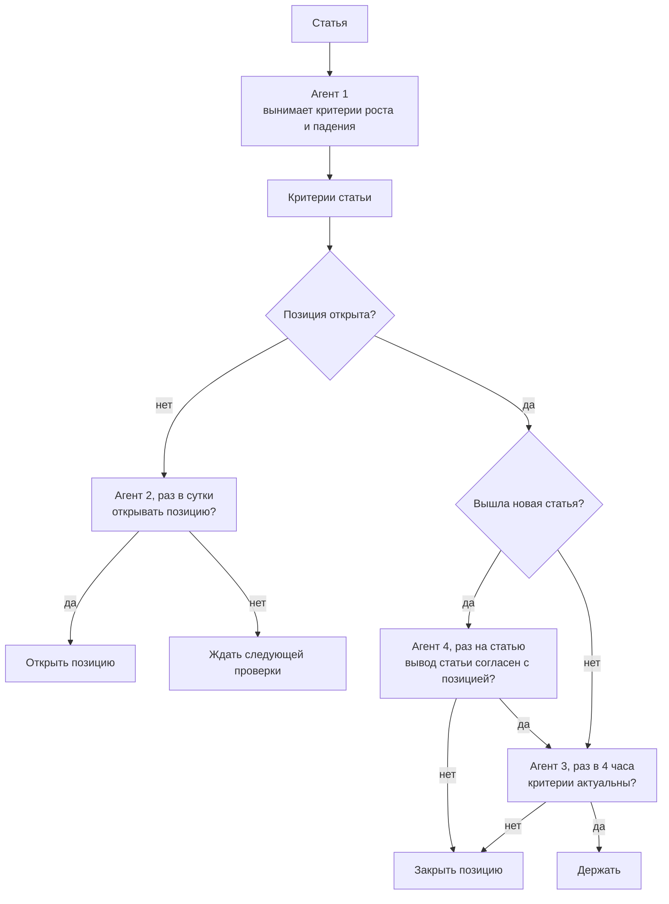

# План работ: конвейер из четырёх агентов

Дата: 2026-11-01

## 1. Схема

Решения принимают агенты. Словаря фич и предикатов нет: что считать по свечам, агент решает сам и считает через `bash`.

## 2. Агенты

### Агент 1: критерии

Запускается один раз на статью, результат кэшируется по `article.id`. На вход получает текст и графики обзора. Находит условия, при которых автор ожидает рост или падение цены BTC. Если таких условий нет, возвращает пустой список: это нормальный ответ.

Кроме списка критериев ответ содержит `description`, описание результата, и `reasoning`, каких данных не хватило.

Ответ по каждому критерию:

| Поле | Значение |
|---|---|
| `id` | номер критерия |
| `direction` | `up` или `down` |
| `condition` | условие своими словами |
| `level` | уровень цены или `null` |
| `horizon` | срок из статьи или `null` |
| `evidence_quote` | дословная цитата из статьи |

### Агент 2: вход

Запускается раз в сутки, когда позиции нет: это idle-пинг frame с `entryInterval: "1d"`. Такая частота сокращает число запросов к модели. На вход получает сообщения статьи, критерии отдельными сообщениями и свечи файлами. Проверяет, наступили ли критерии, и сам решает, открывать ли позицию: критерии это доводы, отображения `met` в `action` нет.

Ответ:

| Поле | Значение |
|---|---|
| `criteria[].id` | номер критерия |
| `criteria[].met` | наступил или нет |
| `criteria[].level_tests` | сколько раз цена тестировала уровень, `null` если уровня нет |
| `criteria[].evidence` | обоснование по данным |
| `action` | `long`, `short` или `wait` |
| `description` | описание решения, уходит в `note` сигнала |
| `reasoning` | каких данных не хватило для ответа |

### Агент 3: выход

Запускается раз в 4 часа, когда позиция открыта: это active-пинг frame с `watchInterval: "4h"`. На вход получает сообщения статьи, все критерии из `State`, данные позиции и свечи файлами. Проверяет, актуальны ли критерии. Если нет, закрывает позицию.

Ответ:

| Поле | Значение |
|---|---|
| `criteria[].id` | номер критерия |
| `criteria[].relevant` | актуален или нет |
| `criteria[].evidence` | обоснование по данным |
| `action` | `hold` или `close` |
| `description` | описание решения, уходит в `note` закрытия |
| `reasoning` | каких данных не хватило для ответа |

### Агент 4: сверка с новым прогнозом

Запускается один раз на каждую новую статью, пока позиция открыта, раньше агента 3 на той же проверке. Статья, по которой позиция открыта, сверку не проходит: её уже прочитал агент 2. На вход получает статью целиком, её критерии, данные позиции с причиной открытия и исходными критериями, свечи файлами. Определяет, чего автор ждёт от цены, сверяет это с направлением позиции и решает, закрывать ли её. Отображение `forecast` в `action` не задано: решение остаётся за агентом. Если агент закрыл позицию, агент 3 на этой проверке не вызывается. Если агент 4 упал, агент 3 всё равно работает, а сверка повторяется на следующей проверке.

Ответ:

| Поле | Значение |
|---|---|
| `forecast` | `supports`, `contradicts` или `neutral`: вывод статьи относительно направления позиции |
| `evidence_quote` | дословная цитата с выводом автора, `null` только при `neutral` |
| `action` | `hold` или `close` |
| `description` | описание решения, уходит в `note` закрытия |
| `reasoning` | каких данных не хватило для ответа |

### Подписки на пинг

Открытую позицию обслуживают три подписки в `main.strategy.ts`. backtest-kit вызывает их в порядке подписки, и сбой одной не останавливает следующие.

| Порядок | Подписка | Условие | Что делает |
|---|---|---|---|
| 1 | `listenActivePingFilter` | статьи нет в `articleIds` | добавляет критерии статьи в `State` |
| 2 | `listenActivePingFilter` | статьи нет в `reviewedArticleIds` | вызывает агента 4 |
| 3 | `listenActivePingFilter` | `getPendingSignal` вернул сигнал | вызывает агента 3 |

Порядок подписок важен: агент 3 должен получить критерии новой статьи. После `commitClosePending` пинг доходит до следующей подписки: `hasPendingSignal` остаётся `true`, а `getPendingSignal` возвращает `null`, и `State` на этом пинге уже недоступен. Поэтому агент 3 фильтруется по `getPendingSignal`.

### Отладка

Поля `reasoning` агентов пишутся в лог через `Log.info` и остаются в кэше ответов. По ним видно, каких данных агентам не хватает: их читают перед правкой промпта или входных данных.

### Свечи

Агенты 2, 3 и 4 получают три файла, анализируют их через `bash`:

| Файл | Таймфрейм | Глубина | Период |
|---|---|---|---|
| `candles_1d.csv` | 1d | 30 свечей | месяц |
| `candles_1h.csv` | 1h | 168 свечей | неделя |
| `candles_1m.csv` | 1m | 240 свечей | 4 часа |

Свечи берутся через `getCandles` backtest-kit, поэтому в файлы попадают только закрытые свечи на момент проверки.

### Состояние позиции

Агенты реализованы в `classes/Agent.ts` по образцу `Dataset.ts`: один экземпляр `Agent`, `State` это поле класса. Время и сигнал `State` получает из контекста backtest-kit.

Критерии открытой позиции хранятся в `State` из backtest-kit, включается через `State.enable()`. `State` привязан к сигналу, поэтому живёт ровно от открытия до закрытия позиции.

| Поле | Значение |
|---|---|
| `articleIds` | статьи, чьи критерии уже учтены |
| `criteria` | все критерии позиции: при открытии из `payload` сигнала, затем добавляются критерии новых статей |
| `history` | ответы агента 3 по каждой проверке |
| `reviewedArticleIds` | статьи, уже сверенные с позицией |
| `reviews` | ответы агента 4 по каждой новой статье |

Пока позиции нет, `State` недоступен: агент 2 получает критерии из кэша агента 1.

## 3. Что остаётся за кодом

- Передача свечей через `getCandles` и статей, вышедших к текущему моменту.
- Открытие и закрытие позиции по ответу агента: `commitCreateSignal`, `commitClosePending`.
- Проверка, что `evidence_quote` дословно есть в статье. Критерий без такой цитаты отбрасывается.
- Проверка, что `evidence_quote` агента 4 дословно есть в статье, если `forecast` не `neutral`.
- Проверка, что `id` в ответах агентов 2 и 3 совпадают с переданными критериями.
- Биржевой стоп: между проверками за позицией никто не следит.
- Кэш ответов агентов через `Cache.file`.
- Состояние позиции через `State`.

## 4. Значения по умолчанию

| Вопрос | По умолчанию | Почему |
|---|---|---|
| Направление | `long` и `short` | критерии бывают и на рост, и на падение |
| Стоп | 7,5 % через `Position.moonbag` | значение из `kondratyev_trading` |
| Какие критерии получает агент 3 | статьи, по которой открыта позиция, и всех вышедших после неё | «все критерии» можно понять по-разному |
| Какие критерии получает агент 2 | только последней вышедшей статьи | следующий обзор заменяет предыдущий |
| Срок позиции | без лимита, `CC_MAX_SIGNAL_LIFETIME_MINUTES: Infinity` задаёт `@backtest-kit/cli` | закрытие по сроку вынуждает переоткрывать позицию. В конце frame открытую позицию закрывает backtest-kit |
| Глубина свечей | 30 × 1d, 168 × 1h, 240 × 1m | месяц, неделя и последние 4 часа |

## 5. Этапы работ

### Этап 1. Агент 1

Написано: `prompt/agent1.mustache`, схема ответа в `classes/Agent.ts`, стратегия по образцу `kondratyev_trading` с `addStrategySchema` без `getSignal`.

Прогон по статьям сентября 2026 выполнен, результаты в `content/sep_2026/dump`, см. [DUMP.md](DUMP.md).

**Результат:** таблица критериев по каждой статье с цитатами.

**Контрольная точка.** Таблицу смотрите вы. Если критериев почти нет или они не про цену, агентам 2 и 3 проверять будет нечего, и план пересматривается до следующих этапов.

### Этап 2. Агент 2

Написано: `prompt/agent2.mustache`, схема ответа, передача статьи и критериев сообщениями, свечей файлами, открытие позиции со стопом в `listenIdlePing`, `entryInterval: "1d"` во frame.

Прогон сентября 2026 выполнен.

**Результат:** список решений за сентябрь: момент, критерий, число касаний, обоснование, действие.

### Этап 3. Агент 3

Написано: `prompt/agent3.mustache`, схема ответа, `State` позиции, закрытие в `listenActivePing`, `watchInterval: "4h"` во frame.

Прогон сентября 2026 выполнен.

**Результат:** полный бэктест сентября: сделки, причины входа и выхода, PnL после издержек.

## 6. Новые месяцы

Новый месяц это копия `content/sep_2026` в `content/<mon>_<yyyy>`. В `modules/backtest.module.ts` меняется только frame:

| Поле | Значение для августа 2026 |
|---|---|
| `frameName` | `aug_2026_frame` |
| `startDate` | `2026-08-01T00:00:00Z` |
| `endDate` | первое число следующего месяца, `2026-09-01T23:59:59Z`: день на добор траекторий |
| `note` | `AUG 2026 (+1 день на добор 24h-траекторий)` |

`entryInterval` и `watchInterval` не меняются. `classes/`, `prompt/` и датасет общие, в корне проекта. Датасет покрывает публикации с 2023-06-12 по 2026-10-02.

## 7. Известные риски

- **Расход запросов.** За месяц около 30 запросов агента 1, до одного запроса агента 2 в сутки, до шести запросов агента 3 в сутки и до одного запроса агента 4 на статью, через ключ из `docker/agent/.env`.
- **Воспроизводимость.** Ответы модели держатся на кэше. После смены промпта или модели кэш удаляется вручную, а результат будет другим.
- **Малая выборка.** Один месяц даёт мало сделок: он проверяет работу конвейера, но не доказывает прибыльность.
