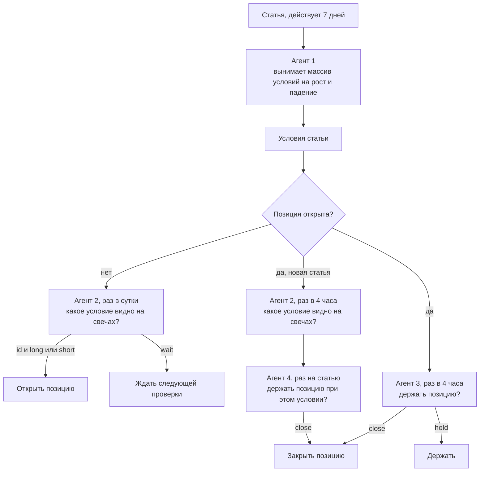

# План работ: конвейер из четырёх агентов

Дата: 2026-11-01

## 1. Схема

Решения принимают агенты. Статью читает только агент 1, остальные получают условия и свечи файлами. Булевых полей в ответах нет: агент смотрит свечи и возвращает элемент массива или действие. Вывод автора в цепочке не участвует, потому что торговать сентимент статьи нельзя.

Статья действует 7 дней. Новая статья заменяет её и сбрасывает отсчёт. Если статьи за 7 дней нет, условий нет.

## 2. Агенты

### Агент 1: условия

Запускается один раз на статью, результат кэшируется по `article.id`. На вход получает текст и графики обзора. Находит условия, при которых автор ожидает рост или падение цены BTC. Если таких условий нет, возвращает пустой список: это нормальный ответ.

Кроме списка условий ответ содержит `description`, описание результата, и `reasoning`, каких данных не хватило.

Ответ по каждому условию:

| Поле | Значение |
|---|---|
| `id` | номер условия |
| `direction` | `up` или `down` |
| `condition` | условие своими словами |
| `level` | уровень цены или `null` |
| `horizon` | срок из статьи или `null` |
| `evidence_quote` | дословная цитата из статьи |

### Агент 2: вход

Запускается, пока статья действует: без позиции раз в сутки и сразу после закрытия, при открытой позиции раз в 4 часа, пока условие новой статьи не увидено. На вход получает массив условий и свечи файлами. Смотрит свечи и достаёт из массива условие, которое на них видно.

| Поле | Значение |
|---|---|
| `id` | `id` условия или `null` |
| `position` | `long`, `short` или `wait` |
| `description` | что агент увидел на свечах, уходит в `note` сигнала |
| `reasoning` | каких данных не хватило для ответа |

Если позиции нет, код открывает позицию в направлении `position`. Если позиция открыта, условие новой статьи добавляется в `State` и передаётся агенту 4.

### Агент 3: выход

Запускается раз в 4 часа, когда позиция открыта: это active-пинг frame с `watchInterval: "4h"`. На вход получает условия из `State`, данные позиции и свечи файлами.

| Поле | Значение |
|---|---|
| `action` | `hold` или `close` |
| `description` | что агент увидел и почему так решил, уходит в `note` закрытия |
| `reasoning` | каких данных не хватило для ответа |

### Агент 4: сверка с новой статьёй

Запускается один раз на каждую новую статью, пока позиция открыта, когда агент 2 увидел её условие на свечах. Запускается раньше агента 3 на той же проверке. Статья, по которой открыта позиция, сверку не проходит. На вход получает условие, описание от агента 2, данные позиции с причиной открытия и исходными условиями, свечи файлами. Ответ такой же, как у агента 3. Если агент закрыл позицию, агент 3 на этой проверке не вызывается. Если агент 4 упал, агент 3 всё равно работает, а сверка повторяется на следующей проверке.

### Подписки на пинг

Открытую позицию обслуживают три подписки в `main.strategy.ts`. backtest-kit вызывает их в порядке подписки, и сбой одной не останавливает следующие.

| Порядок | Подписка | Условие | Что делает |
|---|---|---|---|
| 1 | `listenActivePingFilter` | статьи нет в `articleIds` | добавляет условие статьи в `State`, когда оно видно на свечах |
| 2 | `listenActivePingFilter` | статьи нет в `reviewedArticleIds` | вызывает агента 4 |
| 3 | `listenActivePingFilter` | `getPendingSignal` вернул сигнал | вызывает агента 3 |

Порядок подписок важен: агент 3 должен получить условие новой статьи. После `commitClosePending` пинг доходит до следующей подписки: `hasPendingSignal` остаётся `true`, а `getPendingSignal` возвращает `null`, и `State` на этом пинге уже недоступен. Поэтому агент 3 фильтруется по `getPendingSignal`.

### Отладка

Поля `reasoning` агентов пишутся в лог через `Log.info` и остаются в кэше ответов. По ним видно, каких данных агентам не хватает: их читают перед правкой промпта или входных данных.

### Свечи

Агенты 2, 3 и 4 получают три файла:

| Файл | Таймфрейм | Глубина | Период |
|---|---|---|---|
| `candles_1d.csv` | 1d | 30 свечей | месяц |
| `candles_1h.csv` | 1h | 168 свечей | неделя |
| `candles_1m.csv` | 1m | 240 свечей | 4 часа |

Свечи берутся через `getCandles` backtest-kit, поэтому в файлы попадают только закрытые свечи на момент проверки.

### Состояние позиции

Агенты реализованы в `classes/Agent.ts` по образцу `Dataset.ts`: один экземпляр `Agent`, `State` это поле класса. Время и сигнал `State` получает из контекста backtest-kit. `State` привязан к сигналу и живёт от открытия до закрытия позиции.

| Поле | Значение |
|---|---|
| `articleIds` | статьи, чьи условия уже учтены |
| `criteria` | условия позиции: при открытии из `payload` сигнала, затем добавляются условия новых статей |
| `history` | ответы агента 3 по каждой проверке |
| `reviewedArticleIds` | статьи, уже сверенные с позицией |
| `reviews` | ответы агента 4 по каждой новой статье |

## 3. Что остаётся за кодом

- Передача свечей через `getCandles` и статей, вышедших к текущему моменту.
- Открытие и закрытие позиции по ответу агента: `commitCreateSignal`, `commitClosePending`.
- Проверка, что `evidence_quote` дословно есть в статье. Условие без такой цитаты отбрасывается.
- Проверка ответа агента 2: `id` есть в массиве, а `position` совпадает с направлением условия.
- Биржевой стоп: между проверками за позицией никто не следит.
- Кэш ответов агентов через `Cache.file`.
- Состояние позиции через `State`.

## 4. Значения по умолчанию

| Вопрос | По умолчанию | Почему |
|---|---|---|
| Направление | `long` и `short` | условия бывают и на рост, и на падение |
| Стоп | 7,5 % через `Position.moonbag` | значение из `kondratyev_trading` |
| Срок позиции | без лимита, `CC_MAX_SIGNAL_LIFETIME_MINUTES: Infinity` задаёт `@backtest-kit/cli` | закрытие по сроку вынуждает переоткрывать позицию. В конце frame открытую позицию закрывает backtest-kit |
| Какие условия получает агент 2 | все условия последней статьи не старше 7 дней | следующий обзор заменяет предыдущий |
| Какие условия получает агент 3 | условие открытия и условия новых статей, которые агент 2 увидел на свечах | позиция держится на подтверждённых условиях |
| Глубина свечей | 30 × 1d, 168 × 1h, 240 × 1m | месяц, неделя и последние 4 часа |

## 5. Этапы работ

Написано: промпты в `prompt/`, схемы в `classes/Agent.ts`, стратегия в `content/sep_2026/main.strategy.ts`.

Осталось: полный бэктест сентября 2026 на текущей схеме, затем другие месяцы.

**Результат:** сделки, причины входа и выхода, PnL после издержек в сравнении с удержанием BTC.

## 6. Новые месяцы

Новый месяц это копия `content/sep_2026` в `content/<mon>_<yyyy>`. В `modules/backtest.module.ts` меняется только frame:

| Поле | Значение для августа 2026 |
|---|---|
| `frameName` | `aug_2026_frame` |
| `startDate` | `2026-08-01T00:00:00Z` |
| `endDate` | первое число следующего месяца, `2026-09-01T23:59:59Z`: день на добор траекторий |
| `note` | `AUG 2026 (+1 день на добор 24h-траекторий)` |

`entryInterval` и `watchInterval` не меняются. `classes/`, `prompt/` и датасет общие, в корне проекта. Датасет покрывает публикации с 2022-07-06 по 2026-10-31, но до 2025 года статей мало: всего 18.

## 7. Известные риски

- **Расход запросов.** За месяц около 30 запросов агента 1, до одного запроса агента 2 в сутки без позиции и до шести при открытой позиции, до шести запросов агента 3 в сутки и до одного запроса агента 4 на статью, через ключ из `docker/agent/.env`.
- **Воспроизводимость.** Seed и температура в запросе не задаются, поэтому на одних и тех же данных модель может ответить по-разному. Ответы прогона держатся на кэше. После смены промпта или модели кэш удаляется вручную, а результат будет другим.
- **Малая выборка.** Один месяц даёт мало сделок: он проверяет работу конвейера, но не доказывает прибыльность.
