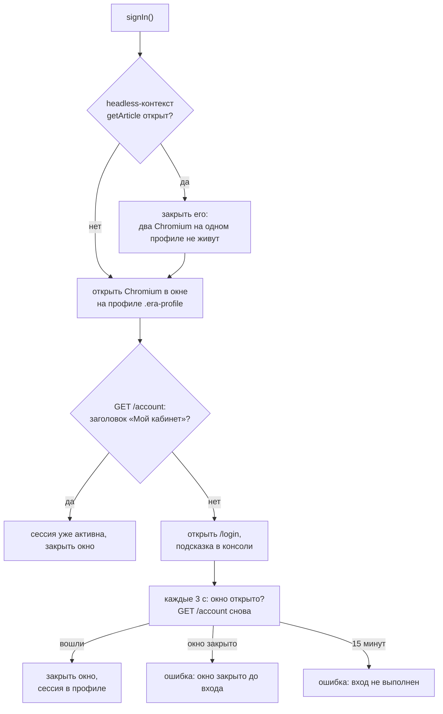
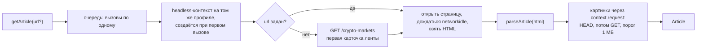
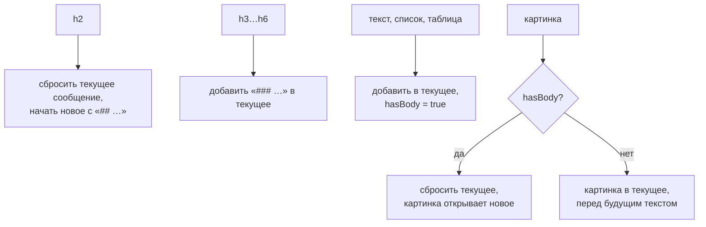

# Browser: живые обзоры с eraperemen.info

Документ описывает [classes/Browser.ts](../classes/Browser.ts): как класс
входит на сайт, забирает статью и превращает её в запись того же формата, что
строки `assets/wwwroot.jsonl`. Исторические данные читает `Dataset`
([DATASET.md](DATASET.md)), живые даёт `Browser`; стратегия получает одинаковые
объекты из обоих источников.

## 1. Назначение

Датасет заканчивается 2026-10-02, а в лайве стратегии нужен сегодняшний обзор.
`Browser.getArticle()` открывает сайт в Chromium под сохранённой сессией,
находит самую свежую статью и возвращает её как `Article`: `id`, `when`,
`format`, `publishedAt`, `messages` с текстом в markdown и графиками в base64.
Доступ к полному тексту платный, поэтому сначала выполняется ручной вход.

Наружу торчат два метода одного экземпляра `Browser`:

| Метод | Что делает |
|---|---|
| `signIn()` | открывает окно Chromium, ждёт ручного входа, сохраняет сессию в профиле |
| `getArticle(url?)` | возвращает статью по адресу, без адреса берёт первую из ленты |

Разбор страницы вынесен из класса в функции модуля: `parseArticle(html, options)`
и `firstArticleUrl(html, base)` экспортируются и работают без браузера, остальные
вспомогательные функции внутренние.

## 2. Сессия: `signIn`

Сессия живёт в профиле Chromium `.era-profile`, который создаёт
`launchPersistentContext`. Это обычная папка профиля: куки и localStorage
переживают перезапуски, экспорт состояния не нужен. Папка в `.gitignore`.
Путь к ней берётся из `globalThis[Symbol.for("root_path")]`, который задаёт
`config/loader.config.ts`: CLI backtest-kit меняет рабочую папку при запуске
стратегии, и профиль должен находиться по тому же пути из любого места.



Вход делается руками в открывшемся окне. Сайт подтверждает его письмом, и
ссылку из письма нужно открыть в этом же окне, иначе сессия окажется в другом
браузере. Проверка входа идёт запросами `context.request` к `/account` с куками
профиля, вкладку пользователя она не трогает.

Запуск:

```bash
node --experimental-strip-types scripts/login_browser.ts
```

Скрипт [scripts/login_browser.ts](../scripts/login_browser.ts) вызывает
`Browser.signIn()` и завершает процесс.

## 3. Получение статьи: `getArticle(url?)`



- **Контекст.** Один headless-контекст на процесс, создаётся лениво через
  `singleshot` и переиспользуется. На каждый вызов открывается своя страница и
  закрывается в `finally`. При закрытии контекста ссылка сбрасывается, следующий
  вызов поднимет его заново.
- **Очередь.** Вызовы сериализуются через `queued`: профиль один, страница одна
  за раз. Параллельные `getArticle` по нескольким символам выполняются
  последовательно, а не падают на блокировке профиля.
- **Адрес по умолчанию.** Лента `/crypto-markets` отдаёт карточки
  `article.pcard` в `div.era-feed` от самой свежей к старым; берётся первая
  ссылка. Проверено 30.10.2026: порядок 30.10, 29.10, 28.10, страницы за 31.10
  ещё не было.
- **Загрузка.** `page.goto` до `domcontentloaded`, статус 400 и выше это
  ошибка, затем ожидание `networkidle` до 20 секунд, которое не роняет вызов по
  таймауту. Таймаут навигации 60 секунд.
- **Картинки.** Качаются запросами контекста, то есть с куками сессии и тем же
  User-Agent, что у страницы. Сначала HEAD: если `content-length` больше 1 МБ,
  картинка пропускается без скачивания. Иначе GET, проверка статуса, пустого
  тела и размера уже по факту. Кэш base64 по адресу на 200 записей.

Один вызов занимает около 5 секунд, запись с четырьмя графиками весит
примерно 160 КБ.

Пример использования, [scripts/fetch_article.ts](../scripts/fetch_article.ts):
забирает первую статью ленты и пишет её в `tmp/article.json`.

```bash
node --experimental-strip-types scripts/fetch_article.ts
```

## 4. Формат записи

Запись совпадает с строкой `wwwroot.jsonl`, стандарт снят со всех 698 записей
датасета.

| Поле | Значение |
|---|---|
| `id` | случайный UUID |
| `when` | дата обзора `dd.mm.yyyy` |
| `format` | строка `dd.mm.yyyy` |
| `publishedAt` | `yyyy-mm-ddT00:00:00+03:00`: на странице нет времени, только дата, поэтому полночь в часовом поясе сайта |
| `messages` | массив `{ role: "user", content, images? }` |

Первое сообщение: заголовок `# Обзор рынка криптовалют dd.mm.yyyy`, пустая
строка, затем `Дата: …`, `Рубрика: …` (если у статьи есть бейдж рубрики) и
`Источник: …` с canonical-адресом. Если тело начинается с таблицы метрик, она
попадает в это же сообщение. Обложка проходит общий порог размера: легче 1 МБ
становится картинкой первого сообщения, тяжелее отсекается. В датасете она
отсечена у 696 записей из 698, у живого сайта тоже тяжелее порога.

Остальные сообщения:

- каждый `h2` открывает новое сообщение со строкой `## …`, `h3` остаётся внутри
  как `### …`, в середине текста `## ` не встречается;
- картинка после текста открывает новое сообщение, поэтому `images` всегда
  стоят перед `content`; картинка перед следующим `h2` даёт сообщение без текста;
- источники идут отдельным сообщением `## Источники и время данных` со списком
  ссылок;
- картинки хранятся как raw base64 без `data:`-префикса.

Запись за 30.10.2026 из живого прогона, десять сообщений:

| # | Картинок | Начало `content` |
|---|---|---|
| 0 | 0 | `# Обзор рынка криптовалют 30.10.2026`, `Дата`, `Рубрика`, `Источник` |
| 1 | 1 | `## Криптовалютный индекс страха и жадности` |
| 2 | 0 | `## Ключевые новости криптоиндустрии`, внутри `### …` по новостям |
| 3 | 1 | `## Биткоин` |
| 4 | 1 | `## Эфириум` |
| 5 | 1 | `## Альткоины` |
| 6 | 0 | `## Инвестиционные сигналы`, список |
| 7 | 0 | `## Ключевые риски`, список |
| 8 | 0 | `## Главный вывод дня` |
| 9 | 0 | `## Источники и время данных`, список ссылок |

## 5. Разбор разметки

Разметка статьи и что из неё получается:

| Элемент | Результат |
|---|---|
| `header.article-head` → `p.era-badges`, `time[datetime]`, `h1` | рубрика, дата, заголовок первого сообщения |
| `p.article-cover > img` | картинка первого сообщения при размере до 1 МБ |
| `div.article-body` | тело, обходится по порядку дочерних элементов |
| `p.era-preview` | скрытый тизер, пропускается |
| `table` | markdown-таблица: заголовок, разделитель `---`, строки |
| `h1`, `h2` | `## …`, новое сообщение |
| `h3` … `h6` | `### …` и глубже, в текущем сообщении |
| `ul`, `ol` | список `- …` или `1. …` |
| блок с `img` (`div`, `figure`, `p`) | каждая картинка в `images`, `figcaption` курсивом |
| `div`, `section` с блоками внутри | рекурсивный обход |
| `section.era-sources` | сброс текущего сообщения и обход как отдельного раздела |
| `script`, `style`, `noscript`, `button`, `.article-speech`, `details.disclaimer` | пропускаются |
| остальное (`p` и прочее) | абзац через строчную разметку |

Строчная разметка: `a` → `[текст](абсолютный адрес)`, при этом `[S07]` в тексте
ссылки становится `S07`; `strong`/`b` → `**…**`; `em`/`i` → `*…*`; `br` →
перенос строки; `img` внутри строки игнорируется, картинки берутся на уровне
блоков. Пробелы и неразрывные пробелы схлопываются, края обрезаются.

Накопитель сообщений держит текущий текст, картинки и флаг `hasBody`: попало
ли в сообщение что-то кроме заголовка. Правила:



Сброс создаёт сообщение, только если в нём есть текст или картинки, поэтому
пустых сообщений не бывает.

Дата публикации ищется по порядку: `time[datetime]` в шапке статьи, любой
`time[datetime]` в статье, видимая дата в бейдже, дата из slug адреса
(`…-28-10-2026`). Если не нашлась ничем, статья отклоняется с ошибкой: без
даты запись бесполезна для `Dataset`-подобных потребителей.

Адрес страницы для относительных ссылок и строки `Источник:` берётся из
`link[rel="canonical"]`, при его отсутствии из фактического адреса страницы.

## 6. Ошибки

Все ошибки начинаются с `Browser:`.

| Сообщение | Причина | Что делать |
|---|---|---|
| `тело статьи скрыто, сессия не авторизована, выполните Browser.signIn()` | `.article-body` пустой и скрытый, в шапке ссылка «Войти» | запустить `scripts/login_browser.ts` |
| `тело статьи пустое, у аккаунта нет доступа к материалу` | то же без ссылки «Войти» | проверить подписку |
| `HTTP 4xx/5xx for …` | страница не отдалась | адрес, доступность сайта |
| `на странице нет <article>` или `нет .article-body, разметка изменилась` | разметка сайта поменялась | обновить селекторы в `parseArticle` |
| `не найдена дата публикации` | нет `time[datetime]`, бейджа и даты в адресе | проверить страницу |
| `image 404: …`, `empty image body` | картинка не скачалась | статья падает целиком, повторить позже |
| `картинка больше 1 МБ пропущена` (предупреждение, не ошибка) | обложка или тяжёлый график | ничего, так формировался датасет |
| `в ленте … не найдено ни одной статьи` | лента без карточек или новая разметка | проверить `/crypto-markets` |
| `окно закрыто до завершения входа`, `вход не выполнен за 15 минут` | `signIn` без результата | повторить вход |

## 7. Ограничения

- Парсер привязан к разметке сайта: проверен на статьях 02.10.2026 и живых
  28.10–30.10.2026. Смена вёрстки ломает его явной ошибкой, а не тихо.
- Сессия истекает по правилам сайта, тогда `getArticle` падает с подсказкой
  выполнить вход. Вход только ручной: подтверждение письмом.
- `publishedAt` это полночь даты по Москве, а не момент публикации: времени на
  странице нет. Обзор за день D становится доступен в `Dataset` с 21:00Z дня
  D-1, живая статья появляется на сайте позже, когда её опубликуют.
- Одна статья за раз, около 5 секунд на вызов. Для истории использовать
  `Dataset`, не `Browser`.
- Playwright требует свой Chromium: `npx playwright install chromium`
  (для Playwright 1.64 это сборка 1248). Два Chromium на одном профиле
  одновременно не запускаются, поэтому `signIn` закрывает headless-контекст.
