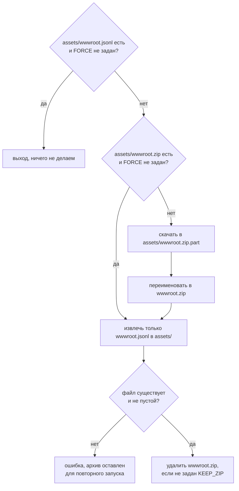

# Архитектура: датасет ежедневных обзоров

Документ описывает две части конвейера данных: как датасет попадает в проект
(`scripts/`) и как бэктест читает его во время прогона (`classes/Dataset.ts`).
Логика стратегии и агентов описана в [AGENT.md](AGENT.md) и здесь не рассматривается.

## 1. Данные

Источник: Hugging Face, датасет `tripolskypetr/market-forecasting-dataset`,
файл `assets/wwwroot.zip`.

| Что | Значение |
|---|---|
| Архив | 424 МБ, ZIP, шифрование ZipCrypto (не AES), пароль `123` |
| Внутри архива | `wwwroot.jsonl` (568 МБ, deflate) и случайно попавший `wwwroot.zip` (51 МБ), второй не извлекается |
| Строк в jsonl | 698, по одной на день публикации |
| Размер строки | от 107 КБ до 3,4 МБ |
| Доля текста | 1,6 % (9 МБ на весь файл), остальное base64-картинки |
| Период | публикации с 2023-06-12 по 2026-10-02, 698 дней из 1209 календарных, 511 пропусков |
| Порядок строк | лексикографический по полю `when` (`01.02.2024` раньше `01.03.2024`), не хронологический |

Одна строка:

```json
{
  "id": "c51c2dae-...",
  "when": "07.09.2023",
  "format": "dd.mm.yyyy",
  "publishedAt": "2023-09-07T00:00:00+03:00",
  "messages": [
    { "role": "user", "content": "# Обзор рынка криптовалют 07.09.2023 ..." },
    { "role": "user", "content": "## Новостной блок ...", "images": ["/9j/4AAQ...", "iVBORw0..."] }
  ]
}
```

`publishedAt` у всех записей ровно `T00:00:00+03:00`: обзор за день D считается
опубликованным в полночь по Москве, то есть в 21:00 UTC предыдущего дня.
`images` хранят jpeg и png в base64 без `data:`-префикса.

Из размера строк следует главное ограничение: файл нельзя держать в памяти
целиком, а порядок строк не позволяет найти день без индекса.

## 2. Скачивание

Два скрипта с одинаковой схемой работы:
[scripts/linux/fetch_dataset.sh](../scripts/linux/fetch_dataset.sh) для Linux и macOS,
[scripts/windows/fetch_dataset.bat](../scripts/windows/fetch_dataset.bat) для Windows.
Запускать можно из любой папки: пути считаются от расположения скрипта
(`scripts/<os>/../..` это корень проекта).



**Скачивание.** Linux: `curl -fL --retry 3`, при отсутствии curl `wget`.
Windows: встроенный `curl.exe` (Windows 10 1803+), при отсутствии PowerShell
`WebClient.DownloadFile` с принудительным TLS 1.2. Файл качается во временный
`.part` и переименовывается только после успешного завершения, поэтому
обрыв не оставляет битого `wwwroot.zip`.

**Распаковка.** Архив защищён ZipCrypto, этот алгоритм умеют снимать
стандартные инструменты, поэтому 7-Zip не обязателен. Скрипт берёт первый
доступный инструмент из цепочки:

| Linux и macOS | Windows |
|---|---|
| `unzip -P` | 7-Zip из PATH или `Program Files` |
| `7z`, `7zz`, `7za` | `tar.exe` (libarchive, Windows 10 1803+) |
| `bsdtar --passphrase` | Python 3 (`py -3` или `python`), модуль `zipfile` |
| `python3`, модуль `zipfile` | |

Извлекается только `wwwroot.jsonl`, лишний `wwwroot.zip` внутри архива
игнорируется.

**Проверка.** После распаковки скрипт требует, чтобы `assets/wwwroot.jsonl`
существовал и был непустым. Это обязательно: `unzip` при неверном пароле пишет
`skipping` и может завершиться с кодом 0.

**Поведение при ошибке.** Если распаковка не удалась, архив остаётся в
`assets/`, и повторный запуск использует его без перекачки 424 МБ.
При неудачном скачивании `.part` удаляется.

Переменные окружения:

| Переменная | Действие |
|---|---|
| `FORCE=1` | перекачать и распаковать, даже если jsonl уже есть |
| `KEEP_ZIP=1` | не удалять архив после распаковки |

## 3. Чтение: `classes/Dataset.ts`

Класс [classes/Dataset.ts](../classes/Dataset.ts) повторяет форму `Dataset.ts` из
`backtest-kit-template` (`content/apr_2022`): инициализация через `singleshot`,
одна точка входа, фильтр без look ahead, выбор последнего по публикации.
Отличие одно: образец хранил в `_valueMap` сами записи, здесь хранится
положение строки в файле, а запись читается при обращении.

Наружу торчит один метод:

```ts
Dataset.getArticle(when: Date): Promise<Article | null>
```

Он возвращает обзор, который был известен на момент `when`, целиком, вместе с
картинками. Всё остальное, индекс, чтение по смещению, кэш, это детали
реализации, стратегия о них не знает.

### Инициализация: индекс строк

`waitForInit` выполняется один раз при первом обращении. Генератор
`iterateLines` идёт по файлу потоком и отдаёт байты каждой строки вместе с её
смещением от начала файла. Для каждой строки:

1. `JSON.parse` всей строки, обычный разбор, без эвристик по тексту;
2. ключ = календарная дата `publishedAt` в UTC (формат `dd.mm.yyyy`);
3. в `_indexMap[ключ]` добавляется `{ offset, length }`;
4. распарсенная запись отбрасывается.

В памяти после инициализации остаётся только индекс: около 698 пар чисел.
Строка живёт в памяти ровно пока парсится, поэтому пик занимает одна строка,
не файл. Смещение следующей строки считается как `offset + length + 1`, что не
зависит от `\r` и кодировки содержимого.

### Запрос: окно 7 дней и фильтр по публикации

Обзор действует 7 дней. Новый обзор заменяет его и сбрасывает отсчёт. Если за 7 дней обзора не было, довода нет, и метод возвращает `null`.

Шаги `getArticle(when)`:

1. идёт от UTC-даты `when` назад, не дальше чем на 7 дней;
2. `readDay(ключ)` читает день из `_cacheMap` или по смещению через `readLine`;
3. остаются записи, у которых `publishedAt <= when` и возраст не больше 7 дней;
4. проход останавливается на первом дне с такой записью, из неё берётся последняя по `publishedAt`;
5. из `_cacheMap` удаляются все ключи, кроме просмотренных этим запросом.

Корзины берутся по UTC-дате `publishedAt`, а не по полю `when`, потому что обзор за день D публикуется в 21:00Z дня D-1 и лежит в UTC-корзине D-1. Корректность обеспечивает не корзина, а фильтр на шаге 3: до своего `publishedAt` запись не возвращается.

Дни без обзора не читают файл, а найденный день остаётся в кэше, поэтому повторные вызовы файл не читают. Новая строка читается один раз, когда появляется обзор.

### Чтение строки

`readLine({ offset, length })` открывает файл, читает `length` байт с позиции
`offset` циклом до полного заполнения буфера, парсит JSON и закрывает файл.
Дескриптор не держится открытым между вызовами: чтений за прогон столько же,
сколько дней пройдено, и стоимость открытия пренебрежимо мала.

### Семантика результата

Метод отвечает на вопрос «какой обзор действует на момент `when`». В выходные и в пропусках датасета (511 дней без обзора) он возвращает последний обзор, пока тому не больше 7 дней, затем `null`. Время публикации доступно в `publishedAt` возвращённой записи.

## 4. Инварианты и ограничения

- Файл не должен меняться, пока процесс работает: индекс хранит байтовые
  смещения. После обновления датасета процесс перезапускается.
- Путь `./assets/wwwroot.jsonl` относительный от CWD, как и в образце.
  CLI backtest-kit запускается из корня проекта.
- Память: индекс плюс распарсенные строки просмотренных дней, обычно одна-две. Весь файл в память не попадает ни на одном этапе.
- Записи возвращаются как есть, с картинками. Если стратегии нужен только
  текст, она берёт `messages[].content` сама.
- `assets/wwwroot.jsonl` не покрыт `.gitignore`: правило `wwwroot` совпадает
  только с именем без расширения. Файл весит 542 МБ, в репозиторий его
  добавлять нельзя.
