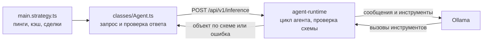

# agent-runtime: исполнение агентов

Как агенты из [AGENT.md](AGENT.md) обращаются к модели: что делает agent-runtime, как он запускается в проекте и как его вызывает код.

## 1. Что это

[agent-runtime](https://github.com/tripolskypetr/agent-runtime) это REST-сервис, который запускает AI-агента поверх Ollama. Запрос содержит сообщения, файлы и JSON-схему ответа. Сервис возвращает объект по этой схеме.

У агента три инструмента:

| Инструмент | Назначение |
|---|---|
| `provide_answer` | единственный способ закончить, аргументы проверяются по схеме |
| `bash` | команды в рабочей папке, в том числе `python3` и `jq` |
| `read_file` | чтение файла из рабочей папки: текст с `offset` и `limit` или картинка, которую видит модель с vision |



За время, свечи и сделки отвечает backtest-kit, за модель, повторы и историю запросов отвечает agent-runtime.

## 2. Как устроен один инференс

1. Сервис очищает рабочую папку и записывает в неё файлы запроса. Картинки из сообщений в папку не попадают: они идут модели прямо в сообщении и сохраняются в SQLite.
2. Агент работает с инструментами, пока не вызовет `provide_answer` с аргументами, подходящими под схему.
3. Отклонённый вызов `provide_answer` возвращается модели как ошибка инструмента с указанием поля, и она исправляет ответ в пределах `MAX_TURNS`.
4. Если модель закончила работу без принятого ответа, например ответила текстом, сервис требует вызвать инструмент и запускает её снова на той же переписке, всего до `MAX_ATTEMPTS` запусков.
5. Запрос, транскрипт и результат сохраняются в SQLite, рабочая папка очищается.

Инференсы выполняются строго по одному, остальные запросы ждут в очереди. Ответ приходит только после завершения агента.

Настройки по умолчанию:

| Переменная | Значение | Смысл |
|---|---|---|
| `MAX_ATTEMPTS` | 3 | запуски агента на одной переписке, пока нет принятого ответа |
| `MAX_TURNS` | 120 | ходы модели на один инференс, счётчик общий для всех запусков |
| `INFERENCE_TIMEOUT_MS` | 900000 | предел на один инференс |
| `BASH_TIMEOUT_SEC` | 120 | таймаут команды `bash` |
| `BODY_LIMIT_MB` | 256 | размер тела запроса |

Ошибки:

| Код | HTTP | Причина |
|---|---|---|
| `invalid_format` | 400 | схема не компилируется, инференс не запускался |
| `schema_mismatch` | 500 | за все попытки нет валидного ответа |
| `max_turns` | 500 | исчерпаны ходы модели |
| `timeout` | 500 | превышен `INFERENCE_TIMEOUT_MS` |
| `provider_error` | 500 | ошибка Ollama: ключ, модель или хост |
| `internal_error` | 500 | внутренняя ошибка сервиса |

## 3. Запуск в этом проекте

Конфигурация лежит в [docker/agent](../docker/agent/):

```bash
cd docker/agent
cp .env.example .env    # вписать OLLAMA_API_KEY
docker compose up -d
curl -s http://localhost:10050/api/v1/health | jq
```

| Переменная `.env` | Значение |
|---|---|
| `OLLAMA_HOST` | `https://ollama.com` |
| `OLLAMA_API_KEY` | ключ с https://ollama.com/settings/keys |
| `OLLAMA_MODEL` | `kimi-k2.7-code`, модель для кодинга с tools и vision |
| `OLLAMA_VISION` | `1`, картинки из сообщений `user` уходят модели, `read_file` показывает ей картинки из файлов |

Файл `.env` с ключом в git не попадает. Остальные настройки описаны в README agent-runtime, раздел Configuration.

Адреса после запуска:

| Адрес | Что там |
|---|---|
| http://localhost:10050/docs | Swagger |
| http://localhost:10050/admin | история инференсов, без пароля |
| http://localhost:10050/api/v1/health | модель и состояние очереди |

База лежит в `docker/agent/storage/agent-runtime.sqlite`, лог в `docker/agent/logs/debug.log`. Образ собран под `linux/amd64`, на Apple Silicon работает через эмуляцию.

## 4. Вызов из стратегии

Клиент это пакет [agent-runtime-sdk](https://www.npmjs.com/package/agent-runtime-sdk). Встроенный `fetch` обрывает запрос без ответа через 300 секунд, поэтому `classes/Agent.ts` передаёт ему dispatcher из `undici` без таймаутов. `undici` сейчас приходит транзитивно и в `package.json` не указан:

```bash
npm i undici@7.29.1 --save-exact
```

| Файл | Что в нём |
|---|---|
| [classes/Agent.ts](../classes/Agent.ts) | схемы ответов, запросы к модели, проверка ответов, `State` позиции |
| [content/sep_2026/main.strategy.ts](../content/sep_2026/main.strategy.ts) | `Cache.file`, пинги, открытие и закрытие позиции |
| [prompt/](../prompt/) | промпты агентов |

Состав запроса:

| Поле | Содержимое |
|---|---|
| `instructions` | промпт агента из `prompt/*.mustache` |
| `messages` | сообщения статьи с картинками, критерии, данные позиции, все с ролью `user` |
| `files` | `candles_1d.csv`, `candles_1h.csv`, `candles_1m.csv` |
| `format` | схема ответа, литерал в `defineFormat` |

Модель в запросе не указывается, её задаёт `.env`.

`format` это JSON Schema draft 2020-12 с объектом на верхнем уровне. Ссылки `$ref` допустимы только локальные, вида `#/$defs/...`. Схема хранится литералом в `.ts`, чтобы тип ответа выводился из неё с точными значениями `enum`.

`generateObject` при ошибке бросает `AgentRuntimeError` с полями `code`, `details` и `inferenceId`. Исключение бросает и проверка ответа в `Agent.ts`. `Cache.file` сохраняет только успешный результат, поэтому такой вызов повторится на следующей проверке.

## 5. Особенности работы

**Кэш.** Ответы хранятся на диске через `Cache.file`, повторный прогон их не запрашивает.

| Агент | `name` | `interval` | Ключ |
|---|---|---|---|
| 1 | `agent1_v1` | `1d` | символ и id статьи |
| 2 | `agent2_v1` | `4h` | символ и выровненное время |
| 3 | `agent3_v1` | `4h` | символ, выровненное время и id сигнала |
| 4 | `agent4_v1` | `1d` | символ, id статьи и id сигнала |

После смены схемы, промпта агента или модели кэш удаляется вручную, иначе подмешаются старые ответы: папка агента в `dump/data/measure`. Чтобы сохранить кэш, скопируйте его в `./tmp`. `name` при этом не меняется.

**Частота.** Агент 2 вызывается раз в сутки, агент 3 раз в 4 часа: частоту задают `entryInterval` и `watchInterval` во frame. Агент 4 вызывается один раз на каждую новую статью при открытой позиции.

**Картинки.** Графики статьи передаются в `messages[].images`, и при `OLLAMA_VISION=1` модель видит их прямо в сообщении. Картинка остаётся в переписке и уходит модели заново с каждым ходом, поэтому увеличивает время ответа и расход токенов.

В рабочую папку такие картинки не записываются, поэтому `bash` и `read_file` их не видят. Чтобы обработать картинку инструментами, её нужно передать в `files`.

При `OLLAMA_VISION=0` и в сообщениях с ролью `assistant` или `system` модель получает вместо картинки метку `[image omitted: not visible to the model]`. Сама картинка при этом остаётся в истории.

**Результаты.** Ответы агентов и сделки прогона лежат в `dump`, см. [DUMP.md](DUMP.md).

## 6. Диагностика

| Где | Что |
|---|---|
| http://localhost:10050/admin | транскрипт, запрос, вложения, ошибка по попыткам; поиск и страницы внизу списка |
| `GET /api/v1/inferences/:id` | то же через API |
| `GET /api/v1/inferences?status=error` | неудачные инференсы |
| `GET /api/v1/inferences?q=текст` | поиск без учёта регистра по запросу, результату, ошибке, id и модели |
| `docker/agent/logs/debug.log` | все события в JSON lines |
| `docker compose logs -f agent-runtime` | те же события в stdout |

Вложения различаются полем `kind`:

| `kind` | Что это |
|---|---|
| `image` | картинка из сообщения |
| `file` | файл запроса |
| `tool_image` | картинка, открытая через `read_file` |
| `output` | файл, созданный агентом |

Один инференс целиком:

```bash
grep '<inference id>' docker/agent/logs/debug.log | jq -c '.args'
```

## 7. Ссылки

- [agent-runtime](https://github.com/tripolskypetr/agent-runtime): API, настройки, логирование
- [agent-runtime-sdk](https://github.com/tripolskypetr/agent-runtime/tree/master/packages/sdk): клиент и вывод типов
- [AGENT.md](AGENT.md): агенты и план работ
- [DATASET.md](DATASET.md): источник статей
