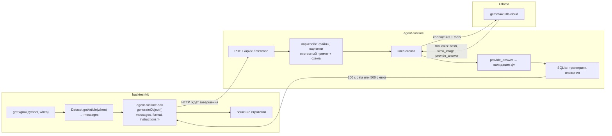

# agent-runtime: исполнение агентов

Документ описывает, что такое agent-runtime, как он поднимается в этом проекте
(`docker/agent/`) и как стратегия backtest-kit отдаёт ему данные и получает
ответ. Логика самих агентов описана в [AGENT.md](AGENT.md), источник данных в
[DATASET.md](DATASET.md).

## 1. Что это

[agent-runtime](https://github.com/tripolskypetr/agent-runtime) это REST-харнесс
для AI-агента на базе [pi](https://github.com/earendil-works/pi) поверх Ollama.
Один HTTP-запрос содержит переписку (текст и картинки), набор файлов и
JSON-схему ответа. Сервис запускает агента с тремя инструментами в изолированной
рабочей папке, добивается от модели ответа строго по схеме и возвращает объект.
Это серверный аналог пары `generateObject` / `generateText` из json-inference,
которой пользуется референсная стратегия `crypto_yoda_channel`.

| Инструмент агента | Назначение |
|---|---|
| `provide_answer` | Единственный способ закончить. Параметры инструмента это схема `format` из запроса, аргументы валидируются |
| `bash` | Shell в рабочей папке: `python3`, `jq`, ImageMagick, таймаут 120 с, обрезка вывода |
| `view_image` | Показать картинку из рабочей папки vision-модели |

Зачем он в этом проекте. По AGENT.md конвейер состоит из трёх агентов, каждый
обязан вернуть JSON по схеме и имеет право на расчёты. Агент получает полный
текст обзора и его графики, то есть ровно запись `wwwroot.jsonl`. Формат
`messages` в запросе agent-runtime совпадает с форматом записи датасета
(`role`, `content`, `images` в base64), поэтому результат `Dataset.getArticle(when)`
передаётся в запрос без преобразований.

Разделение ролей:



backtest-kit отвечает за время (`when`), свечи, отсутствие look ahead и
кэширование. agent-runtime отвечает за инференс: модель, повторы, валидацию,
историю. Стратегия не знает ни про Ollama, ни про tool calling.

## 2. Как устроен один инференс

Последовательность из `src/agent/runInference.ts`:

1. **Рабочая папка** (`DATA_DIR`, в контейнере `/app/data`) очищается. В неё
   пишутся `files` из запроса и картинки из сообщений как
   `images/message_<i>_<j>.<ext>`.
2. **Сообщения.** `user` идут модели как есть; при `OLLAMA_VISION=1` картинки
   прикладываются к сообщению, иначе остаются только файлами в папке.
   `system` сообщения сворачиваются в дополнительные инструкции системного
   промпта. `assistant` вставляется как синтетический ответ модели. Если
   последнее сообщение не от `user`, добавляется «Proceed with the task.».
3. **Системный промпт** рендерится из `assets/system.mustache`: путь к папке,
   список файлов и картинок, схема ответа, правила, поле `instructions` из
   запроса как раздел «Additional instructions». Среди правил: `null` это
   JSON null, а не строка; при `oneOf` выбирается ровно одна ветка; `const`
   копируется дословно; лишние свойства запрещены.
4. **Цикл агента.** Модель вызывает инструменты, пока не вызовет
   `provide_answer` с валидными аргументами. Аргументы проверяет ajv по
   исходной схеме `format`; для pi-agent-core инструмент объявлен с
   разрешающей схемой, чтобы его скупые сообщения об ошибках не подменяли
   ajv. Вызовы инструментов после принятого ответа блокируются.
5. **Повторы.** Если попытка закончилась без принятого ответа, в ту же
   переписку добавляется требование вызвать `provide_answer` и модель
   спрашивается снова, до `MAX_ATTEMPTS` раз. Текст валидатора уходит модели
   как результат инструмента и остаётся в деталях ошибки, например
   `signal.direction: must be exactly "long"`.
6. **Сохранение.** Файлы, созданные агентом, транскрипт, картинки, запрос и
   результат пишутся в SQLite. Папка очищается.

Коды ошибок (тело `{ status: "error", error: { code, message, details } }`, HTTP 500, кроме `invalid_format`):

| Код | Когда | Что делать |
|---|---|---|
| `invalid_format` | HTTP 400 до инференса: схема `format` не компилируется, например `$ref` на отсутствующий `$defs`; запись в базе не создаётся | исправить схему, текст ajv в `message` |
| `schema_mismatch` | за `MAX_ATTEMPTS` попыток не было валидного `provide_answer` | уточнить `description` полей, проверить `enum`, упростить схему, посмотреть транскрипт |
| `max_turns` | модель сделала `MAX_TURNS` вызовов без ответа | модель зациклилась на `bash`; сократить задачу или запретить расчёты в инструкциях |
| `timeout` | превышен `INFERENCE_TIMEOUT_MS` | медленная модель или длинная задача |
| `provider_error` | Ollama вернула ошибку | ключ, имя модели, хост |
| `empty_answer` | только `/text`: модель закончила без текста | |
| `internal_error` | исключение харнесса | смотреть `logs/debug.log` |

Лимиты по умолчанию: три попытки, сорок ходов модели, 15 минут на инференс,
120 секунд на одну bash-команду, 256 МБ на тело запроса.

**Очередь.** Рабочая папка одна, поэтому инференсы исполняются строго по
одному. Параллельные запросы ждут своей очереди, ответ приходит после
завершения. `GET /api/v1/health` показывает `running` и `queued`.

**Длинные ответы.** Ответ отправляется только по завершении агента, это может
занять минуты. Встроенный `fetch` в Node обрывает запрос без заголовков ответа
через 300 секунд, поэтому клиенту нужен `undici` dispatcher без таймаутов
(см. раздел 4). Сам сервер таймаута на запрос не имеет.

## 3. Запуск в этом проекте

Конфигурация лежит в [docker/agent](../docker/agent/):

| Файл | Назначение |
|---|---|
| `docker-compose.yaml` | образ `tripolskypetr/agent-runtime:latest`, порт 10050, тома `./storage` и `./logs`, healthcheck |
| `.env.example` | шаблон переменных: `OLLAMA_HOST`, `OLLAMA_API_KEY`, `OLLAMA_MODEL`, `OLLAMA_VISION` |
| `.env` | рабочие значения с ключом, в git не попадает |

```bash
cd docker/agent
cp .env.example .env          # вписать OLLAMA_API_KEY с https://ollama.com/settings/keys
docker compose up -d
curl -s http://localhost:10050/api/v1/health | jq
```

После старта доступны Swagger `http://localhost:10050/docs`, админка с историей
инференсов `http://localhost:10050/admin` (без пароля) и health. Рядом с compose
появятся `storage/agent-runtime.sqlite` (все запросы, транскрипты, вложения) и
`logs/debug.log` (JSON lines, одна строка на событие, ротация на 100 МБ).

Образ собран только под `linux/amd64`, на Apple Silicon работает через
эмуляцию, это заложено в compose строкой `platform`. Обновление:
`docker compose pull && docker compose up -d`.

Локальная Ollama вместо облака: в `.env` задать
`OLLAMA_HOST=http://host.docker.internal:11434` с пустым ключом и раскомментировать
`extra_hosts` в compose (см. эталонный
[config/docker-compose.yaml](https://github.com/tripolskypetr/agent-runtime/blob/master/config/docker-compose.yaml)).

Отличие нашего `.env.example` от эталонного в репозитории agent-runtime: там
дополнительно задано `OLLAMA_THINK=false`, у нас переменная не задана, значит
режим размышления остаётся на усмотрение модели; все проверки схем агентов
мейнтейнер гонял с `OLLAMA_THINK=false`. Остальные настройки
(`MAX_ATTEMPTS`, `MAX_TURNS`, `INFERENCE_TIMEOUT_MS`, `OLLAMA_NUM_CTX`,
`OLLAMA_TEMPERATURE`, `MODEL_SCHEMA_REF_DEPTH`, логирование) берутся по
умолчанию и при необходимости дописываются в `.env`. Полный список в README
agent-runtime, раздел Configuration.

Проверка на реальной записи датасета одним запросом:

```bash
head -n 1 assets/wwwroot.jsonl | jq '{
  messages: .messages,
  format: {
    type: "object",
    required: ["summary", "sentiment"],
    properties: {
      summary:   { type: "string", description: "Краткое содержание обзора, 2-3 предложения" },
      sentiment: { type: "string", enum: ["bullish", "bearish", "neutral"], description: "Общее настроение" }
    }
  }
}' > /tmp/request.json
curl -s -X POST http://localhost:10050/api/v1/inference \
  -H 'content-type: application/json' -d @/tmp/request.json | jq
```

Тело запроса с картинками обзора весит до 3,4 МБ, это в пределах лимита.
Ответ придёт через десятки секунд или минуты, `curl` таймаута не имеет.

## 4. Вызов из стратегии

Клиент: пакет [agent-runtime-sdk](https://www.npmjs.com/package/agent-runtime-sdk),
типизированный `generateObject` / `generateText` поверх `fetch`. Нужна версия
0.2.0: в ней `format` это полная JSON Schema 2020-12, и тип ответа выводится из
неё целиком (абзац «Схема и типы» ниже). На момент написания 0.2.0 собрана в
рабочем дереве agent-runtime и в npm не опубликована, там лежит 0.1.0 с
урезанным подмножеством. В проект пакет пока не установлен:

```bash
npm i agent-runtime-sdk@^0.2 undici
```

`undici` нужен для dispatcher без таймаутов, у SDK он опциональная peer-зависимость.

Агент 1 из AGENT.md в терминах backtest-kit. Схема агента лежит в проекте одним
литералом `defineFormat` (почему не JSON, см. «Схема и типы» ниже):

```ts
import { addStrategySchema, Cache } from "backtest-kit";
import { generateObject, type InferFormat } from "agent-runtime-sdk";
import { Agent } from "undici";
import { readFile } from "fs/promises";
import { Dataset } from "../classes/Dataset";           // пути зависят от расположения стратегии
import { Agent1Format } from "../schemas/agent1.format"; // схема агента 1 из AGENT.md со вклеенными $defs предиката

// Один dispatcher на процесс: встроенный fetch обрывает запрос без ответа через 300 с
const dispatcher = new Agent({ headersTimeout: 0, bodyTimeout: 0 });

type Agent1Response = InferFormat<typeof Agent1Format>;
// verdict: "summary_only" | "forecast_not_expressible" | "forecast_expressible"
// signal: null | { direction: "long"; asset: "BTC"; entry: Predicate; invalidation: Predicate; ... }

const getAgent1 = Cache.file(
  async (symbol: string, when: Date) => {
    const article = await Dataset.getArticle(when);
    if (!article) {
      return { answer: null };
    }
    const answer: Agent1Response = await generateObject(
      {
        messages: article.messages,                                   // запись датасета как есть, с картинками
        instructions: await readFile("./prompts/agent1.md", "utf-8"), // системный промпт агента 1 из AGENT.md
        format: Agent1Format,
      },
      { dispatcher },                                                 // baseUrl: AGENT_RUNTIME_URL или http://localhost:10050
    );
    return { answer, articleId: article.id, publishedAt: article.publishedAt };
  },
  { interval: "1d", name: "agent1_v1" },
);

addStrategySchema({
  strategyName: "news_claims",
  getSignal: async (symbol, when, currentPrice) => {
    const { answer, publishedAt } = await getAgent1(symbol, when);
    if (!answer || answer.signal === null) {
      return null;
    }
    // здесь answer.signal типизирован как объект: direction "long", предикаты entry и invalidation
    // дальше пост-валидация харнессом (раздел 5) и агенты 2, 3 по AGENT.md
    return null;
  },
});
```

Куда что класть:

| Что | Куда | Почему |
|---|---|---|
| Роль и правила агента (системный промпт из AGENT.md) | `instructions` | попадает в системный промпт разделом «Additional instructions» |
| Текст и картинки обзора | `messages` | это и есть запись датасета |
| Схема ответа | `format` через `defineFormat`, вся схема одним литералом в `.ts` | тип ответа выводится из схемы: `enum` и `const` остаются литералами, `signal` получает `\| null`; импорт из `.json` расширил бы их до `string` |
| Модель | не передавать | задаётся на сервере в `.env`; поле `model` только для разовых экспериментов |

Ошибки. `generateObject` бросает `AgentRuntimeError` с полями `code`, `details`
(по строке на попытку) и `inferenceId`, по которому транскрипт открывается в
админке. Если исключение в стратегии нежелательно, `inference()` возвращает
тот же ответ объектом со `status: "success" | "error"` без throw.

Миграция с json-inference, как в референсной стратегии:

```ts
// было: json-inference, модель и провайдер в коде стратегии
const entry = await generateObject(InferenceName.OllamaInference, { format, messages }, "gemma4:31b-cloud");

// стало: agent-runtime-sdk, модель и ключ на сервере, схема та же
const entry = await generateObject({ format, messages }, { dispatcher });
```

Схемы совместимы: `FormatModel` json-inference принимается без изменений.
Разница в типе ответа: у json-inference со `satisfies FormatModel` enum
расширяется до `string`, у SDK с `defineFormat` остаётся union.

**Схема и типы.** `format` это JSON Schema draft 2020-12 с объектом на верхнем
уровне. Сервер компилирует её ajv (`strict` выключен, `strictSchema: "log"`:
предупреждения о неизвестных ключах уходят в `debug.log`) и проверяет
аргументы `provide_answer` по исходной схеме на любую глубину. Поддерживаются
`oneOf`, `anyOf`, `allOf`, `if`/`then`/`else`, `const`, `enum` любых типов,
`type` массивом с `"null"`, `additionalProperties`, `pattern`,
`minLength`/`maxLength`, `minimum`/`maximum`, `prefixItems`, рекурсия через
`$defs` и `$ref`. Ограничение одно: `$ref` только локальные, `#/$defs/...`,
внешние `$id` не разрешаются. `$schema`, `$id`, `title` допустимы и
игнорируются. Схема, которая не компилируется, даёт 400 `invalid_format` до
инференса.

Модели схема уходит в производном виде: без `$schema`, `$id`, `title`,
`examples`, `default`, с `$ref`, раскрытыми на глубину `MODEL_SCHEMA_REF_DEPTH`
(по умолчанию 3, на срезе остаётся `description`). На `gemma4:31b-cloud`
схема агента 1 проходит и без раскрытия (`0`): 4,5 КБ параметров инструмента
против 6,1 КБ. Значение `3` оставлено ради локальных моделей, на которых
`$ref` не проверялся.

Тип ответа в SDK выводится из той же схемы: `InferFormat<typeof F, Depth = 6>`.
Порядок разбора: `$ref`, затем `const`, `enum`, `oneOf`/`anyOf` (union веток),
`allOf` (пересечение), массив типов (`["string", "null"]` даёт `string | null`),
скаляры, массив, объект; `if`/`then` на тип не влияют. По `$ref` вывод идёт на
`Depth` уровней, глубже тип `unknown`: для предиката AGENT.md это пять
вложенных `all`/`any`/`not` с точными типами листьев. Предел поднимается
вторым параметром, `InferFormat<typeof F, 10>`. Решение мейнтейнера: контракт
это одна схема в одном `defineFormat`, без второго типа, написанного руками.
Для схемы агента 1 целиком это 34 тысячи инстанциаций и 0,14 с работы `tsc`.

Следствие для хранения схем: литералы `enum`, `const` и `required`
сохраняются только у литерала в `.ts`. Импорт из `.json` расширяет их до
`string` и `string[]`, и `signal` перестаёт быть `| null`. Поэтому схемы в
проекте лежат как `schemas/*.format.ts` с `defineFormat`, а JSON из AGENT.md
служит источником для их генерации.

## 5. На что обратить внимание при переносе стратегии

Выводы из вычитки `backtest-ollama-casual/content/crypto_yoda_channel/main.strategy.ts`,
где вызов LLM уже встроен в `getSignal` backtest-kit.

**Кэш инференсов обязателен.** Референс оборачивает вызов модели в
`Cache.file` с `interval` и `name`. Результат пишется на диск в
`./dump/data/measure/<name>_<interval>_<index>/`, ключ по умолчанию
`${symbol}_${alignMs}`, где `alignMs` это `when`, выровненный по интервалу.
Повторный прогон бэктеста читает ответы с диска и не ходит в agent-runtime.
Следствия:

- `interval` должен совпадать с `entryInterval` фрейма. В `aug_2026_frame`
  это `1d`: `getSignal` вызывается раз в сутки в 00:00Z, обзор за этот день
  опубликован в 21:00Z накануне и уже доступен через `Dataset.getArticle`.
- Смена схемы, промпта или инструкций требует нового `name`
  (`news_claim_v1` → `news_claim_v2`), иначе подмешаются кэшированные ответы
  старой формы. README референса говорит об этом прямо.
- На весь датасет приходится 698 обзоров, инференсы исполняются по одному. На
  схеме агента 1 ответ приходит одним ходом за 2–4 с, при вызовах `bash` и
  повторах это минуты. Первый прогон это от получаса до часов, остальные
  читают кэш.

**Look ahead закрывается до вызова модели.** Референс отдаёт модели только
посты, опубликованные не позже `when` (`scrapeLookback`), а после ответа ещё
раз проверяет свежесть по `message.date`. У нас первое делает
`Dataset.getArticle(when)`: обзор следующего дня не виден до своего
`publishedAt`. Второе остаётся за стратегией: `publishedAt` возвращается вместе
с ответом, горизонты по AGENT.md отсчитываются от него.

**Ответ модели сверяется с известными фактами.** Референс просит модель вернуть
`id` поста и проверяет, что такой пост был в окне (`messages.find`), иначе
сигнал отбрасывается: модель может придумать id. В `main.strategy.ts` при этом
нет проверки `entry.symbol === symbol`, которая есть в шаблонной версии, хотя
в окно попадают посты про несколько монет. У нас `article.id` известен заранее
и модели не нужен, зато обязательна проверка `evidence_quote`: цитата должна
дословно встречаться в тексте обзора, это «сверка эха» из AGENT.md раздел 11.
Правило общее: всё, что харнесс знает сам, он проверяет, а не доверяет модели.

**Схемы AGENT.md проходят без правок.** Схемы агентов 1, 2, 3 с `oneOf` для
`signal`, nullable-полями, `const`, `allOf` с `if`/`then`,
`additionalProperties: false`, `pattern` и рекурсивным предикатом принимаются
сервером дословно и проверяются целиком, см. раздел 4. Единственная правка
техническая: схема агента 1 ссылается на внешний файл
`predicate.schema.json#/$defs/predicate`, а сервер разрешает только локальные
`$ref`, поэтому `$defs` предиката вклеиваются в схему агента, а ссылки
переписываются на `#/$defs/predicate`. Склеенные схемы всех трёх агентов уже
лежат в репозитории agent-runtime в `demo/fixtures/*.schema.json`, схема
агента 1 как литерал `defineFormat` в `packages/sdk/test/agent1.format.ts`
(282 строки); оттуда она копируется в `schemas/agent1.format.ts` проекта.

Проверено мейнтейнером на `gemma4:31b-cloud`. Восемь синтетических случаев
(nullable, `oneOf` с `null`, нарушения `const`, `additionalProperties`,
`pattern`, `if`/`then`, рекурсивный предикат в четыре уровня, невалидный
`$ref`) проходят при обоих значениях `MODEL_SCHEMA_REF_DEPTH`. Схема агента 1
с системным промптом из AGENT.md на четырёх статьях датасета, две из них ещё и
без картинок, дала шесть ответов с первого хода без отклонённых вызовов, по
2,4–3,8 с каждый: три `summary_only`, один `forecast_not_expressible` с двумя
claims и `signal: null` по правилу «только long». Golden-фикстуры A и B
проходят схему на уровне валидатора; на модели их прогнать нельзя, обзоры
22.10.2026 и 23.10.2026 в датасет не входят (он заканчивается 2026-10-02).
Для ветки с непустым `signal` мейнтейнер добавил синтетическую фикстуру C
(`demo/fixtures/agent1.synthetic-c.article.txt` и `agent1.fixture-c.json`):
модель выдала сигнал с теми же уровнями с первого вызова.

**Пост-валидация остаётся за стратегией.** Схема не проверяет дословность
`evidence_quote`, происхождение числовых литералов предикатов из текста,
глубину и число листьев, связь `based_on_claim_ids` с нужными claims.
Референсная реализация этих проверок из AGENT.md разделов 3 и 5 лежит в
agent-runtime в `demo/agent1.check.ts`: на испорченной фикстуре C
(перефразированная цитата, down-claim как основание, выдуманный уровень,
глубина 4) схема проходит, а пост-валидация ловит все четыре дефекта.

**Поле `reasoning` и отладка.** Референс требует от модели `reasoning` и кладёт
его в `note` сигнала. С agent-runtime полный транскрипт каждого инференса
хранится в SQLite и виден в админке по id, поэтому для отладки достаточно
сохранять `inferenceId` в `payload` сигнала. `reasoning` можно оставить: он
дисциплинирует модель.

**Картинки.** Референс картинки постов модели не отдаёт (`omit(message, "photo")`).
В нашем датасете графики это 98 % объёма записи. При `OLLAMA_VISION=1` они
уходят модели и увеличивают время ответа и расход токенов. Если агенту 1
нужен только текст, передавать `messages` без `images`. На двух статьях
датасета ответ агента 1 без картинок совпал с ответом с картинками;
окончательное решение по результатам на фикстурах.

**Таймауты и параллельность.** Один инференс за раз на сервере, от секунд до
минут на ответ. Бэктест по нескольким символам отправит запросы параллельно, они
выстроятся в очередь, и `getSignal` будет ждать. Клиент обязан быть без
таймаута (dispatcher), сервер ограничен `INFERENCE_TIMEOUT_MS`.

## 6. Диагностика

| Где | Что |
|---|---|
| `http://localhost:10050/admin` | список инференсов, транскрипт, запрос, вложения, ошибка с деталями по попыткам |
| `GET /api/v1/inferences/:id` | то же через API; `?status=error` в списке отбирает неудачные |
| `docker/agent/logs/debug.log` | JSON lines: запрос, каждый ход модели, вызовы инструментов, ошибки провайдера |
| `docker compose logs -f agent-runtime` | та же лента в stdout |

Один инференс целиком:

```bash
grep '<inference id>' docker/agent/logs/debug.log | jq -c '.args'
```

Секреты в логе маскируются, строки длиннее 2000 символов (base64, промпты)
обрезаются.

## 7. Ссылки

- [agent-runtime](https://github.com/tripolskypetr/agent-runtime): README с API, конфигурацией и логированием
- agent-runtime, папка `demo/`: склеенные схемы агентов `fixtures/*.schema.json`, фикстуры A, B, C, пост-валидация `agent1.check.ts`, smoke-тесты схем (`npm run test:schema`, `npm run smoke:schema`)
- [agent-runtime-sdk](https://github.com/tripolskypetr/agent-runtime/tree/master/packages/sdk): README клиента, вывод типов, обработка ошибок
- [json-inference](https://github.com/tripolskypetr/json-inference): формат схем `FormatModel`
- [AGENT.md](AGENT.md): конвейер из трёх агентов, схемы ответов, фикстуры
- [DATASET.md](DATASET.md): откуда берутся `messages`
